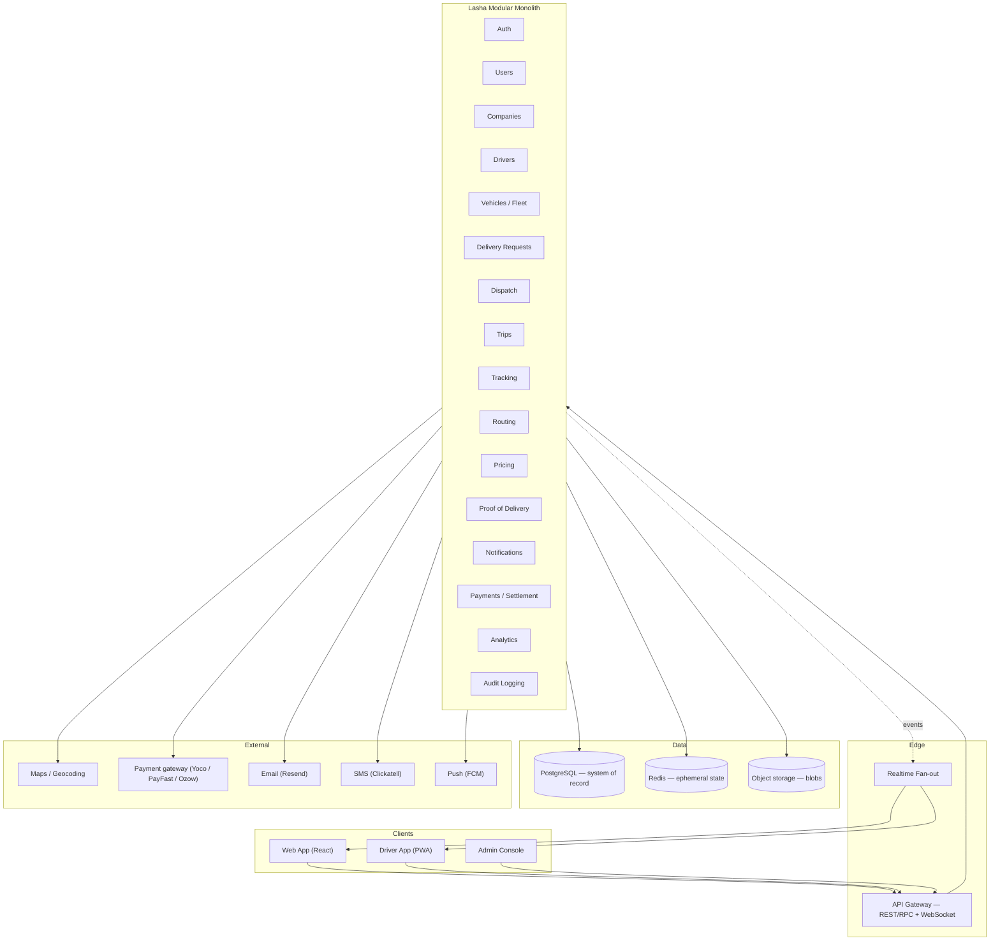
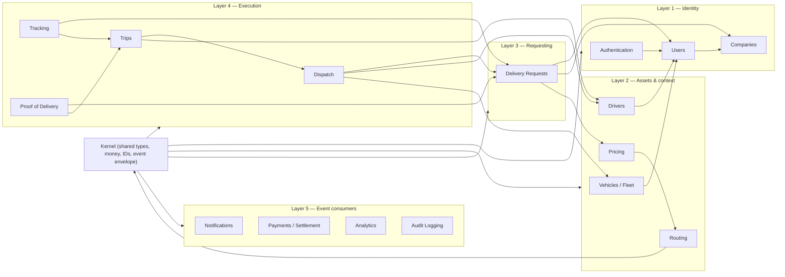
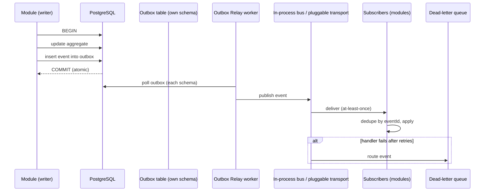
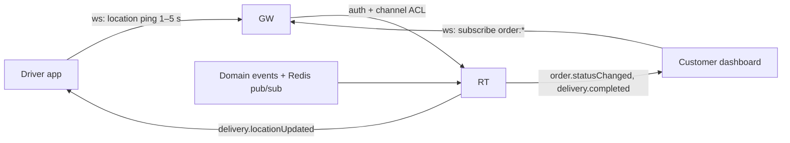
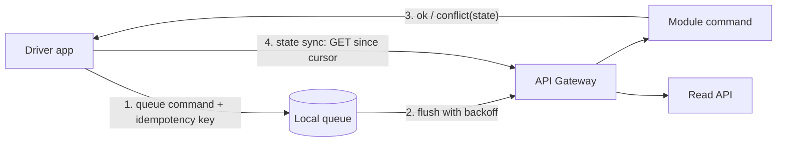
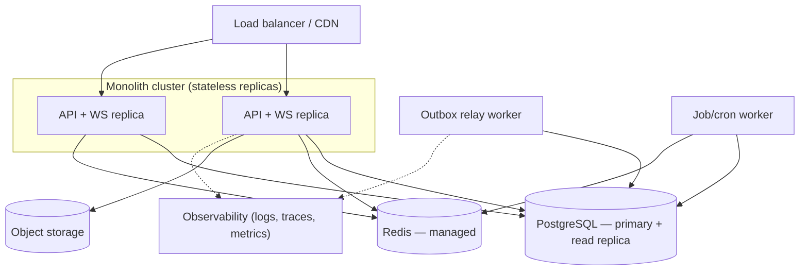

# Lasha Backend Architecture

**Status:** Target architecture for production backend
**Date:** 2026-09-04
**Source of truth:** `docs/backend-ui-contract.md` — canonical spec for entities, roles, statuses, function API names, and access rules
**Runtime target:** Modular monolith (Node.js/TypeScript) + PostgreSQL + Redis + S3-compatible object storage

> This document defines the *production* backend architecture for Lasha. The
> current codebase runs a Convex-based prototype; this architecture describes
> the boundary-respecting service design the prototype's function API
> (`orders.list`, `wallets.topUp`, `tracking_events.getByTrackingId`, …) will be
> re-homed in, keeping those names as the API contract so the frontend does not
> churn. Nothing here is implemented yet.

---

## Table of contents

1. [Guiding principles](#1-guiding-principles)
2. [System overview](#2-system-overview)
3. [Module inventory and boundaries](#3-module-inventory-and-boundaries)
4. [Dependency rules](#4-dependency-rules)
5. [Database responsibility (PostgreSQL)](#5-database-responsibility-postgresql)
6. [Redis responsibility](#6-redis-responsibility)
7. [Event architecture](#7-event-architecture)
8. [External service boundaries](#8-external-service-boundaries)
9. [API architecture](#9-api-architecture)
10. [Real-time architecture](#10-real-time-architecture)
11. [Security architecture](#11-security-architecture)
12. [Offline synchronization architecture](#12-offline-synchronization-architecture)
13. [Deployment architecture](#13-deployment-architecture)
14. [Scaling strategy](#14-scaling-strategy)

---

## 1. Guiding principles

1. **Modular monolith first.** Lasha starts as one deployable service containing
   strictly separated internal modules. Microservices are an *exit strategy*,
   not a starting point.
2. **Single writer per aggregate.** Every domain table has exactly one owning
   module. No module reads or writes another module's tables; all cross-module
   reads go through published query APIs, all cross-module changes go through
   published commands or events.
3. **PostgreSQL is the system of record** for all transactional state
   (requests, assignments, trips, wallets, invoices, notifications, audit).
4. **Redis holds ephemeral, high-frequency state only** (live driver location,
   availability, active sessions, caches, short-lived dispatch offers, rate
   limits). Nothing irreplaceable lives only in Redis.
5. **Object storage holds blobs** (POD photos/signatures, documents, vehicle
   images, avatars). The database stores object references, never file bytes.
6. **Event-driven inside the monolith.** Modules communicate through typed
   domain events written to a transactional outbox in the same DB transaction
   as the state change, then relayed asynchronously. No ad-hoc in-process
   function calls across module boundaries for side effects.
7. **Conventions come from the existing codebase.** Statuses are the canonical
   snake_case enum from the schema (`pending | confirmed | picking_up |
   in_transit | delivered | cancelled`); events follow the contract's existing
   `delivery.locationUpdated` camelCase-verb style; money is integer ZAR cents;
   timestamps are epoch milliseconds.
8. **Idempotency everywhere.** Every command carries an idempotency key; every
   event is processed at-least-once with dedupe, so retries and replays are
   safe.

---

## 2. System overview



**Shape of the monolith.** One process image, three runtime roles started from
it (see [Deployment](#13-deployment-architecture)): the API server (HTTP +
WebSocket), the event relay worker (outbox → subscribers), and the cron/job
worker (settlement runs, invoice generation, retention). Internally, 16 domain
modules plus a shared kernel and platform services:



Arrows are *code dependencies* (import edges). Cross-layer effects that would
violate this graph (e.g., Payments learning about a completed delivery) flow
through **events**, not imports.

---

## 3. Module inventory and boundaries

### 3.1 Contract table ownership

The contract's tables are distributed to exactly one module each:

| Contract table | Owning module | Notes |
|---|---|---|
| `users` | Users | Profile, roles |
| `addresses` | Users | Saved locations (pickup/dropoff **snapshots** live on the order) |
| `support_tickets` | Users | Account self-service + ops support |
| `businesses` | Companies | B2B accounts |
| `driver_profiles` | Drivers | License, rating, shift state |
| `vehicles` | Fleet | Vehicle + specs (`capacityKg`, `hasBrakes`, `isExpress`, …) |
| `orders` | Delivery Requests | Customer-facing request aggregate + canonical status |
| `reviews` | Delivery Requests | Post-delivery feedback; Drivers subscribes for ratings |
| `deliveries` | Dispatch | Assignment/execution bookkeeping (courier, vehicle, timestamps) |
| `tracking_events` | Tracking | Public milestone log (`trackingId`, status, label) |
| `wallets` | Payments | ZAR-cent balance |
| `transactions` | Payments | Ledger entries |
| `invoices` | Payments | Billing documents |
| `notifications` | Notifications | In-app inbox |
| `notification_preferences` | Notifications | Channel toggles |
| `proof_of_delivery` | Proof of Delivery | Recipient, signature ref, photo ref, geo, `completedAt` |
| `documents` | Platform: File & Document Storage | Download catalog (legal, rates, forms, api) |

New production-only tables (`trips`, `trip_stops`, `quotes`, `rate_cards`,
`payment_intents`, `payouts`, `audit_events`, `outbox`, …) are introduced by
the owning modules below; they do not exist in the current schema and are not
needed for the prototype UI contract to keep working.

### 3.2 Domain modules

| # | Module | Responsibility | Owned aggregates (Postgres unless noted) |
|---|---|---|---|
| 1 | **Authentication** | Email-OTP + anonymous + federated (custom JWT) sign-in, session issuance/rotation/revocation, OTP issuance & verification, rate-limited retries | `auth_identities`, `otp_codes`, `sessions` |
| 2 | **Users** | Identity profiles, roles (`admin`, `user`, `member`, `business`, `courier`), saved addresses, account settings, support tickets | `users`, `addresses`, `support_tickets` |
| 3 | **Companies** | B2B accounts, membership, industries, verification, billing relationship with Payments | `businesses`, `company_members` |
| 4 | **Drivers** | Driver onboarding/approval, licenses & documents, ratings, shift (availability) lifecycle | `driver_profiles`, `driver_documents`; live availability → Redis |
| 5 | **Vehicles / Fleet** | Vehicle registry & specs, owner link (courier or company), availability, document/inspection state | `vehicles`, `vehicle_documents` |
| 6 | **Delivery Requests** | Customer delivery requests (parcels), quoting integration, canonical order status machine, order lifecycle, reviews | `orders`, `order_parcels`, `reviews` |
| 7 | **Dispatch** | Driver matching (offer → accept/reject/timeout), assignment, execution bookkeeping, re-dispatch on rejection/failure | `deliveries`, `dispatch_offers` (history) + Redis offers |
| 8 | **Trips** | Physical execution after assignment: journey state machine, arrival/pickup/dropoff events, multi-stop journeys, driver app command intake | `trips`, `trip_stops` |
| 9 | **Tracking** | Public tracking codes, milestone log, live location read side, location history | `tracking_events`, `location_history` |
| 10 | **Routing** | Geocoding, distance/duration, ETA, multi-stop route optimization, cache | route cache (Redis + Postgres snapshot) |
| 11 | **Pricing** | Rate cards, dynamic rules (distance × weight × expedition tier), quote issuance, price snapshot | `rate_cards`, `pricing_rules`, `quotes` |
| 12 | **Proof of Delivery** | POD capture workflow (recipient name, signature, photo), verification state, asset metadata, completion gating | `proof_of_delivery`, `pod_assets` |
| 13 | **Notifications** | In-app inbox, unread counts, preference resolution, channel dispatch (email/SMS/push), templates, delivery logs | `notifications`, `notification_preferences`, `outbound_messages` |
| 14 | **Payments / Settlement** | Wallets, ledger, top-ups, order charges, refunds, invoices, driver payouts, settlement runs, payment gateway abstraction | `wallets`, `transactions`, `invoices`, `payment_intents`, `payouts`, `settlement_runs` |
| 15 | **Analytics** | Event ingestion into read models, business/driver metrics, exports | `analytics_*` read-model tables (event-derived) |
| 16 | **Audit Logging** | Append-only audit trail of security & money events, consumer of domain events + explicit audit records | `audit_events` |

### 3.3 Platform services (not domain modules)

| Service | Responsibility |
|---|---|
| **Kernel** | Shared primitives: `Money` (ZAR cents), typed IDs, canonical status enums, event envelope & types, outbox client, error types, pagination, time, telemetry |
| **API Gateway** | HTTP transport, authn/authz middleware, rate limiting, validation, maps RPC names → module commands/queries |
| **Realtime fan-out** | WebSocket subscriptions; translates domain events into the contract's realtime event names (`order.statusChanged`, `delivery.locationUpdated`, `notification.created`, …) |
| **File & Document Storage** | Blob lifecycle (presigned upload/download URLs, content hashing, AV scan hook), `documents` catalog |
| **Outbox Relay worker** | Reads each module's outbox, publishes to the in-process bus / pluggable transport, retries, DLQ |
| **Job worker** | Cron & queued jobs: settlement runs, invoice PDF generation, statement PDFs, retention, cache warming |

---

## 4. Dependency rules

1. **Downward only.** A module may import from the kernel or from modules in a
   strictly lower layer (as drawn in §2). Same-layer imports are forbidden
   between domain modules; where two modules must coordinate at the same layer,
   they communicate via events or via an application-layer use case in the API
   Gateway that depends on both.
2. **No cross-module data access.** Module repositories may only touch tables
   listed in §3.1/§3.2 as owned by that module. Enforced by (a) DB roles/RLS per
   module schema (§5) and (b) a `dependency-cruiser` / ESLint import rule that
   allows `module/ports/*` and `module/events/*` imports but blocks direct
   internal imports across modules.
3. **Published ports only.** Cross-module synchronous access uses only
   `ports/` interfaces (e.g., `PricingPort.quote()`), implemented internally.
   Internals are never exported.
4. **Events carry snapshots.** Any data a consumer needs is included in the
   event payload so consumers rarely need synchronous reads (and never need
   them for correctness — only for enrichment).
5. **No cycles.** The dependency graph is verified in CI. A cycle fails the
   build.
6. **Extraction readiness.** A module can become a service when: it owns its
   tables (already true), it publishes to the outbox (already true), it
   consumes via the event transport (already true), and its synchronous ports
   are few and small. Lifting a module then means moving the folder to a new
   repo and swapping port implementations for HTTP/gRPC calls.

---

## 5. Database responsibility (PostgreSQL)

### 5.1 Roles

- **PostgreSQL is authoritative** for every aggregate, every money balance,
  every invoice, every notification, every audit record, and the outbox.
- Writes are **transactional with the outbox**: a module changes its aggregate
  and appends its domain events to `{module}.outbox` in the same transaction.
- **One Postgres schema per module** (`auth`, `users`, `companies`, `drivers`,
  `fleet`, `delivery_requests`, `dispatch`, `trips`, `tracking`, `routing`,
  `pricing`, `pod`, `notifications`, `payments`, `analytics`, `audit`,
  `platform`). Schema names are a physical enforcement of the ownership map.
- **Money is integer ZAR cents** in every column (`balance_cents`,
  `amount_cents`). No floats for currency, ever. (`15450` in the current UI
  mock means `1545000` cents = R15 450.00; the API keeps exposing cents.)
- **Timestamps** are `timestamptz` in the DB; the API layer converts to epoch
  ms to preserve the frontend contract.
- **IDs** are ULIDs (sortable, opaque) per aggregate. Public-facing
  identifiers that users type (tracking codes like `HY257845U4`, invoice
  numbers like `INV-2024-001`) are separate human-friendly codes with their own
  uniqueness constraints and check digits — never DB IDs.
- **No cross-module FKs.** Cross-module references are ULID columns without FK
  constraints (ownership is enforced by RLS + application rules, not by the
  DB's referential graph, so modules can be lifted later).

### 5.2 Status model (single canonical enum)

One enum, owned by the kernel and shared by every module, resolves contract
§10.1's three competing vocabularies:

```
pending ──► confirmed ──► picking_up ──► in_transit ──► delivered
   │            │              │              │
   └────────────┴──────────────┴──────────────┴──────► cancelled
```

- `orders.status`, `deliveries.status`, and the UI all speak this enum.
- The Track Delivery stepper's four *labels* (`order_placed`, `picked_up`,
  `in_transit`, `delivered`) become derived display milestones (tracking
  events), not a second status enum. Milestones are produced from lifecycle
  events, never stored as order state.
- Finer execution detail (offer accepted, driver en route, arrived at pickup)
  lives in the owning modules' own state machines (`dispatch_offers.status`,
  `trips.status`) and is projected outward as events + tracking milestones.

### 5.3 Contract-conformance queries

Each contract query maps to a module read port:

| Contract function | Serving module |
|---|---|
| `orders.list`, `orders.get`, `orders.searchByTracking` | Delivery Requests (joins via read ports to Users/Companies, Tracking, Dispatch) |
| `deliveries.getByOrder`, `deliveries.getByCourier` | Dispatch |
| `vehicles.get*` | Fleet |
| `driver_profiles.get*` | Drivers |
| `wallets.getBalance`, `transactions.list` | Payments |
| `invoices.list` | Payments |
| `notifications.list`, `notifications.unreadCount` | Notifications |
| `addresses.list` | Users |
| `tracking_events.list/getByTrackingId` | Tracking |
| `users.currentUser/getProfile` | Users |
| `businesses.get` | Companies |
| `notification_preferences.get` | Notifications |
| `documents.list` | Platform storage |
| `support_tickets.list` | Users |

### 5.4 Migrations

- Per-module migration files in the module folder; one global migration ledger.
- Expand/contract pattern: additive schema changes first, dual-write during
  transition, drop columns in a later deploy.
- Data that crosses a module boundary on extraction is exported by the owning
  module's read API, never by raw SQL from the consumer.

---

## 6. Redis responsibility

Redis holds **recoverable, ephemeral, high-frequency** state only. Every key
family is listed here with its owner and TTL policy; loss of Redis degrades to
the Postgres snapshot + recompute, never to data loss.

| Purpose | Key shape | Type | TTL | Owner |
|---|---|---|---|---|
| Live driver location | `loc:{driverId}` | hash `{lat,lng,heading,speed,ts}` | 30–60 s, refreshed by ping | Tracking |
| Geospatial driver search | `geo:drivers:available` | geo set | member removed when offline | Dispatch |
| Driver availability (live) | `avail:{driverId}` | string `available|busy|offline` | until shift end / heartbeat gap | Drivers |
| Active session registry | `session:{sessionId}` | hash + TTL | refresh window | Authentication |
| Token denylist (logout/rotate) | `deny:{jti}` | string | until JWT expiry | Authentication |
| Dispatch offer (short-lived) | `offer:{deliveryId}` | list of `driverId` + score | 60–120 s accept window | Dispatch |
| Offer dedupe / idempotency | `cmd:{idempotencyKey}` | string result | 24 h | All (kernel) |
| Rate limiting | `rl:{scope}:{key}` | counter window | 1–60 s window | API Gateway |
| Geocode / route cache | `geo:{hash(query)}`, `route:{hash}` | string JSON | 7–30 d | Routing |
| Quote cache (repeat params) | `quote:{hash(params)}` | string cents + meta | 15 min | Pricing |
| Realtime channel buffer | `rt:{channel}` | pub/sub + capped list | seconds | Realtime fan-out |
| Read-model hot cache | `rm:{name}:{key}` | string JSON | 60 s | Analytics |

**Failure semantics.** Driver location falls back to last persisted
`location_history` row and the driver appears "stale" to dispatch until the
next heartbeat; dispatch offers are ephemeral by design (a lost offer simply
expires); availability recomputes from `driver_profiles` + active trips on
restart. Nothing is read *only* from Redis for correctness.

---

## 7. Event architecture

### 7.1 Event naming — adapted to codebase conventions

The contract already uses `delivery.locationUpdated`-style names and camelCase
function verbs (`orders.create`, `wallets.topUp`). The requested event concepts
are adapted to that convention — `<aggregate>.<camelCasePastVerb>` — with the
requested name on the left:

| Requested concept | Adapted event name | Fires when | Published by |
|---|---|---|---|
| DeliveryCreated | `order.created` | Request confirmed & ready (parcel, route, price snapshot) | Delivery Requests |
| — | `order.confirmed` | Scheduled/quote confirmed, entering dispatch | Delivery Requests |
| DriverAssigned | `delivery.assigned` | A driver is formally assigned to a delivery | Dispatch |
| DriverAccepted | `delivery.driverAccepted` | Driver accepts the offer | Dispatch |
| DriverRejected | `delivery.driverRejected` | Driver declines an offer | Dispatch |
| — | `delivery.offerExpired` | Offer window elapsed with no answer | Dispatch |
| DriverArrivedAtPickup | `delivery.driverArrivedAtPickup` | Driver check-in at pickup point | Trips |
| DeliveryPickedUp | `delivery.pickedUp` | Parcel handed to driver | Trips |
| TripStarted | `trip.started` | Vehicle departs pickup toward dropoff(s) | Trips |
| DriverLocationUpdated | `delivery.locationUpdated` (existing contract name) | Location ping crosses cadence/threshold | Tracking |
| DriverArrivedAtDropoff | `delivery.driverArrivedAtDropoff` | Vehicle at dropoff | Trips |
| DeliveryCompleted | `delivery.completed` (existing contract name) | POD verified → delivery closed | Dispatch (after POD) |
| DeliveryFailed | `delivery.failed` | Undeliverable / driver abort mid-run | Trips |
| DeliveryCancelled | `order.cancelled` | Customer/admin cancels (refund path) | Delivery Requests |
| ProofOfDeliveryCreated | `proofOfDelivery.created` | Signature/photo captured | Proof of Delivery |

Supporting events (same naming style, used internally):

`quote.issued`, `payment.succeeded`, `payment.failed`, `wallet.credited`,
`wallet.debited`, `transaction.created` (existing), `invoice.issued`,
`invoice.paid` (existing realtime name: `invoice.statusChanged`),
`notification.created` (existing), `review.created`, `driver.shiftStarted`,
`driver.shiftEnded`, `analytics.dayClosed`.

### 7.2 Transport



- **Outbox:** every module schema has an `outbox` table. Events are appended
  transactionally with the state change (7.1), guaranteeing no lost events.
- **Relay:** one relay worker polls all outbox schemas, publishes in
  `(schema, aggregateId, seq)` order per aggregate, and records a watermark.
- **In-process bus first.** Subscribers register handlers in the same process.
  The bus interface (`EventBus.publish/subscribe`) is the only seam; when the
  first module is extracted, the same outbox relay republishes to a distributed
  transport (Redis Streams, later Kafka) and remote subscribers consume over
  the network — no consumer changes.

### 7.3 Envelope

```jsonc
{
  "eventId": "01J…ULID",
  "type": "delivery.completed",
  "version": 1,
  "occurredAt": 1785234567890,
  "aggregate": { "type": "delivery", "id": "01J…" },
  "actor": { "subjectId": "01J…", "role": "courier", "companyId": null },
  "traceId": "…", "causationId": "offer.accepted#cmd-…",
  "payload": { /* snapshot needed by consumers, ZAR amounts in cents */ }
}
```

### 7.4 Ordering, idempotency, replay

- Per-aggregate ordering is preserved through the outbox watermark and a
  partition key of `aggregate.type:aggregate.id`.
- Consumers dedupe on `eventId` (handled-event table / hash in Redis).
- Handlers are written to be **replay-safe**: they re-assert current aggregate
  state before acting (e.g., a late `delivery.locationUpdated` never moves a
  completed delivery backward).
- Commands carry idempotency keys that double as `causationId` so a retried
  command cannot double-fire an event.

### 7.5 Event → state projections (who reacts to what)

| Event | Reacting modules (subscribe) |
|---|---|
| `order.created` / `order.confirmed` | Dispatch (open for dispatch), Tracking (milestone + tracking code), Notifications, Audit, Analytics |
| `delivery.assigned` / `driverAccepted` / `driverRejected` / `offerExpired` | Trips (plan run), Tracking (milestone), Notifications, Audit, Analytics |
| `delivery.driverArrivedAtPickup` | Tracking, Notifications |
| `delivery.pickedUp` | Tracking, Notifications |
| `trip.started` | Delivery Requests (status → `in_transit`), Tracking, Notifications |
| `delivery.locationUpdated` | Realtime fan-out → subscribers; Routing (ETA refresh); Tracking (throttled history) |
| `delivery.driverArrivedAtDropoff` | Tracking, Notifications, POD (prompt capture) |
| `proofOfDelivery.created` | Dispatch (close delivery), Delivery Requests (status → `delivered`), Tracking (milestone), Notifications, Analytics, Audit |
| `delivery.completed` | Payments (settle/finalize invoice), Analytics |
| `delivery.failed` | Dispatch (re-dispatch or fail), Notifications, Audit |
| `order.cancelled` | Dispatch (abort offers), Payments (refund), Tracking (milestone), Notifications, Audit |
| `payment.*`, `transaction.created` | Notifications, Analytics, Audit |
| `invoice.issued/paid` | Notifications (existing realtime name `invoice.statusChanged`), Analytics |
| `review.created` | Drivers (rating recompute), Analytics |
| `driver.shift*` | Dispatch (availability), Analytics |

---

## 8. External service boundaries

Every external dependency is behind a **port + adapter** inside exactly one
module. Env vars follow the contract.

| Capability | Module owning the adapter | Contract service choice | Env vars |
|---|---|---|---|
| Card/EFT payments | Payments | Yoco (primary), PayFast/Ozow fallback | `YOCO_SECRET_KEY`, `PAYFAST_MERCHANT_ID`, `PAYFAST_MERCHANT_KEY` |
| Email (OTP, invoices, receipts) | Authentication (OTP), Notifications (rest) | Resend | `RESEND_API_KEY` |
| SMS (OTP fallback, driver alerts) | Authentication / Notifications | Clickatell (BulkSMS alt) | `CLICKATELL_API_KEY` |
| Push notifications | Notifications | Firebase Cloud Messaging | `FIREBASE_VAPID_KEY`, `FIREBASE_CONFIG` |
| Maps, geocoding, directions | Routing | Google Maps Platform | `GOOGLE_MAPS_API_KEY` |
| Object storage | Platform storage service | S3-compatible (Convex storage in prototype) | `S3_*` (bucket, region, keys) |
| PDF generation | Job worker (invoices/statements) | Server-side PDF lib | — |

Rules:

- Adapters live inside the owning module (`adapters/`), implement the module's
  port, and are the **only** files allowed to call external HTTP APIs.
- The API Gateway never calls external services directly.
- Outbound calls from handlers are performed **after** the outbox commit, with
  retry + idempotency (payment webhooks and email send confirmations arrive as
  events back into the owning module).

---

## 9. API architecture

- One **typed RPC surface** whose names mirror the contract's Convex function
  names so the frontend migration is mechanical: `orders.list`,
  `orders.create`, `wallets.topUp`, `tracking_events.getByTrackingId`,
  `notifications.markRead`, `proof_of_delivery.create`, etc.
- Transport: JSON over HTTP (`POST /rpc/:module.:function`) plus WebSocket for
  subscriptions. (REST-style endpoints may be added for third-party/business
  APIs later — same handlers, different decorators.)
- Request pipeline per call:
  1. Authenticate (Bearer JWT / session token; anonymous allowed for limited
     read paths).
  2. Authorize against the contract §6.1 RBAC matrix (role + ownership).
  3. Validate inputs (kernel validators shared with modules).
  4. Route to the owning module command/query.
  5. Mutations: enforce idempotency key; return `{ result | conflict }`.
- All mutations are synchronous for the *requesting actor's own state* and
  fire-and-forget for projections (events). Example: `orders.create` returns
  the order + quote; the driver offer, notification, and tracking milestone
  arrive asynchronously.
- Error model: typed codes (`NOT_FOUND`, `UNAUTHORIZED`, `INVALID_STATE`,
  `RATE_LIMITED`, `CONFLICT`, `PAYMENT_REQUIRED`), never raw SQL errors.
- Pagination: cursor-based; lists default to newest-first; unread counts etc.
  are dedicated queries, not client-side filters.

---

## 10. Real-time architecture



- **Subscriptions** mirror the contract §5 realtime events: per-user channels
  (`user:{id}.notifications`, `user:{id}.wallet`), per-order channels
  (`order:{id}`), and driver channels (`delivery:{id}`).
- **Location stream** is high-frequency: pings flow client → gateway →
  Redis (`loc:*`, geo set) and are fanned out to subscribers of the active
  trip; the `delivery.locationUpdated` domain event fires throttled (e.g.,
  ≥5 s / ≥50 m change) so the bus and history are not flooded.
- **Authorization on subscribe:** the gateway checks the actor's role and
  ownership (contract §6.2 rules) against the channel ACL at subscribe time and
  re-checks on each event delivery.
- **Resume:** each channel carries a sequence cursor; clients reconnect and
  replay from the cursor via the capped Redis list, so no update is missed.
- The prototype's Convex reactive queries are the frontend's current
  implementation of "subscribe"; the gateway is the production equivalent.

---

## 11. Security architecture

- **Authentication.** Email-OTP (existing), anonymous sessions, and the
  freebuff custom-JWT federation remain the identity providers. Sessions are
  opaque server-side records (Postgres) with short-lived JWTs (Redis-backed
  active registry + denylist). The `lasha_guest` sessionStorage bypass is a dev
  affordance only and is replaced by real anonymous auth before any production
  deployment (contract §6.3).
- **Authorization.** Every command/query re-asserts role + ownership server
  side using the contract §6.1 matrix and §6.2 access rules. Rules are encoded
  once in the kernel as declarative policies (`orders.read:
  senderId == actor OR courierId == actor OR role == admin`) and enforced in
  (a) the gateway middleware and (b) Postgres RLS per module schema, so a
  module extracted later keeps its guards.
- **Tenant isolation.** Business accounts are scoped by `businessId`; all
  business reads filter through membership (`company_members`) derived from the
  `member`/`business` roles.
- **Secrets.** Env-based today (README: `CONVEX_*`, auth JWKS keys); production
  moves to a secret manager. Secrets never appear in events, logs, or API
  responses.
- **Payments / PCI.** Card data never touches Lasha servers: gateway-hosted
  fields/tokens (Yoco PayFast). We store only `payment_intent` references,
  amounts (cents), and status. Refunds and payouts are idempotent.
- **Data protection.** PII fields (email, phone, license numbers) encrypted at
  rest where the module declares sensitivity; TLS everywhere; audit records
  capture actor + action but never payload secrets.
- **Object storage.** Buckets are private; reads go through short-lived
  presigned URLs (signed per user, TTL ≤ 15 min, content-type locked); POD
  photos/signatures are scanned and immutable (write-once), with retention
  policy applied by the job worker.
- **Abuse controls.** Rate limiting on auth endpoints (OTP send/verify),
  anonymous-account creation, and payment intents; idempotency keys prevent
  double charges; webhooks are signature-verified.

---

## 12. Offline synchronization architecture

Target clients: **driver PWA** (and later customer mobile). Network is
unreliable on the road, so the driver app is offline-first.



1. **Commands are queued locally with idempotency keys** (accept offer, check
   in at pickup, mark picked up, report location, capture POD). The same key is
   retried until acknowledged; the server dedupes.
2. **Conflicts are state-machine conflicts, not arbitrary merges.** The server
   validates transitions (`trips.status`, offer expiry) and returns
   `INVALID_STATE` with the current aggregate; the client reconciles its local
   copy and prompts the driver (e.g., "offer expired") rather than blind
   retrying.
3. **Location buffering.** GPS samples buffer locally (bounded ring) and flush
   in batches when connectivity returns, oldest-first, so the route does not
   show a teleport.
4. **State sync by cursor.** After reconnect the app pulls
   `GET /rpc/trips.getStateSince?cursor=` for its active assignments and
   reconciles with the local projection (events applied to a local snapshot).
5. **POD media upload.** Signature/photo bytes go to object storage via
   presigned PUT (resumable); the `proofOfDelivery.create` command only fires
   after upload succeeds, referencing the stored object. A `pod_assets` row in
   `pending` state survives app restarts.
6. **Notifications & wallet** are read-mostly for the driver; cached locally
   with TTL and refreshed on reconnect.

---

## 13. Deployment architecture



- **One image, three roles.** `lasha-api` (HTTP/WS), `lasha-relay` (outbox),
  `lasha-jobs` (cron). Same container tag; role selected by env.
- **Stateless replicas** behind a load balancer; WebSocket sessions pinned or
  (better) re-attached via the Redis channel cursor on reconnect.
- **Managed data plane:** PostgreSQL (primary + read replica, point-in-time
  recovery), Redis (AOF persistence), S3-compatible object storage with
  versioning + lifecycle rules.
- **Environments:** dev / staging / prod, deployed by CI after typecheck +
  tests + migrations dry-run. Migrations run expand/contract and are applied
  ahead of app rollout.
- **Config:** env for non-secret knobs, secret manager for credentials. No
  config in code or events.
- **Observability:** structured logs with `traceId` (propagated into the event
  envelope), OpenTelemetry traces on command handlers, metrics on outbox lag,
  dispatch acceptance rate, location ping cadence, payment failures.
- **Graceful degradation:** Redis loss → tracking serves last-persisted
  location, dispatch pauses offers (fail closed); object storage loss → POD
  capture defers to device queue (§12); Postgres is the only hard dependency.

---

## 14. Scaling strategy

**Phase A — Monolith (launch).** Single deployable, one Postgres primary +
replica, one Redis. Capacity planning is vertical (CPU/memory) plus 2–3
stateless replicas for HA. This is where Lasha stays until *measured* demand
justifies otherwise.

**Phase B — Scale the monolith (growth).**
- Read scaling: read replica for tracking/history-heavy queries; Redis caches
  for quote, route, and read models.
- Write hot spots: partition high-volume tables by time (`tracking_events`,
  `location_history`, `outbox`, `transactions`) using native partitioning;
  location history is append-only and rollup-able.
- Backpressure: dispatch offers and realtime fan-out already use Redis; push
  notification/email/SMS dispatch is queued via outbox + relay so bursts do not
  hit the API replicas.

**Phase C — Extract modules (only when one of these is true).**
1. A module needs independent scaling (e.g., Tracking absorbs a 10× ping rate
   and skews deployments).
2. A module needs independent release cadence / team ownership (Payments,
   Dispatch).
3. Compliance isolation is required (Payments/PCI scope).
4. Failure isolation matters (Realtime/WebSocket churn must not take down order
   creation).

**Extraction order candidates (each prefixed by hardening the seam):**
1. **Payments / Settlement** — compliance scope, audit-heavy, regulatory
   changes; event + idempotency seams already match a service boundary.
2. **Tracking + Realtime fan-out** — high-frequency, high-volume, different
   scaling profile; its Redis usage is already standalone.
3. **Notifications** — throughput + provider churn, many adapters.
4. **Dispatch** — compute-heavy matching with low latency budgets.

Extraction procedure per module: freeze the port API → move folder to its own
repo/service → point its outbox relay at the shared transport → gateway routes
its RPC names to the new origin → delete the in-monolith copy. The frontend
never notices, because RPC names and event types are unchanged.

**Anti-goals.** No database-per-service fan-out in Phase A; no saga framework
before the first extraction; no Kafka until a second consumer group needs
independent replay; no Kubernetes until replicas > ~6 or multi-region.

---

## Appendix: key decisions vs. the contract

| Contract item | Decision here |
|---|---|
| Status enums (§10.1) | One canonical enum (`pending…delivered/cancelled`); stepper milestones are derived tracking events |
| `deliveries.vehicleId` missing (§10.2) | `deliveries` (Dispatch) references vehicle via ULID; Fleet validates ownership |
| Money (§10.17) | Integer ZAR cents everywhere; UI formatting untouched |
| Realtime event names (§5) | Reused verbatim where they exist (`delivery.locationUpdated`, `notification.created`, …) |
| Function names (§4) | Preserved as the RPC surface (§9) |
| Guest bypass (§6.3 / §10.12) | Dev-only; anonymous auth replaces it before production (§11) |
| Geo indexing (§10.16) | Redis GEO for live driver search; PostGIS optional later for archive queries |
| Convex prototype | Remains the current runtime; this architecture defines the production target the function surface maps onto |
