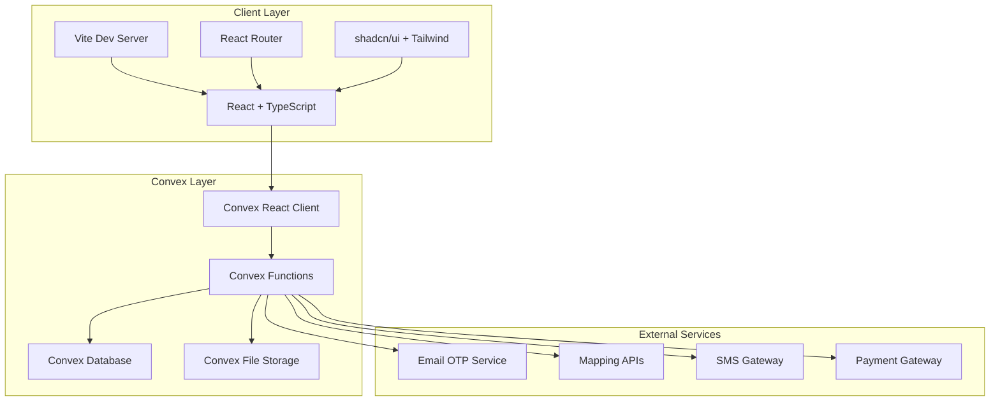
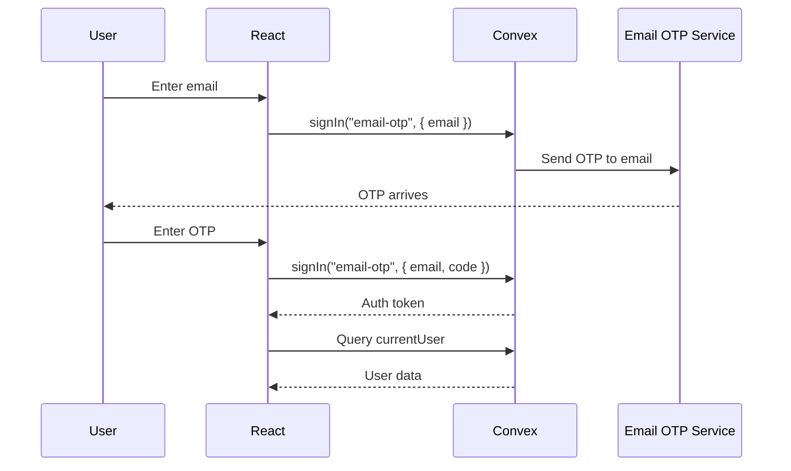
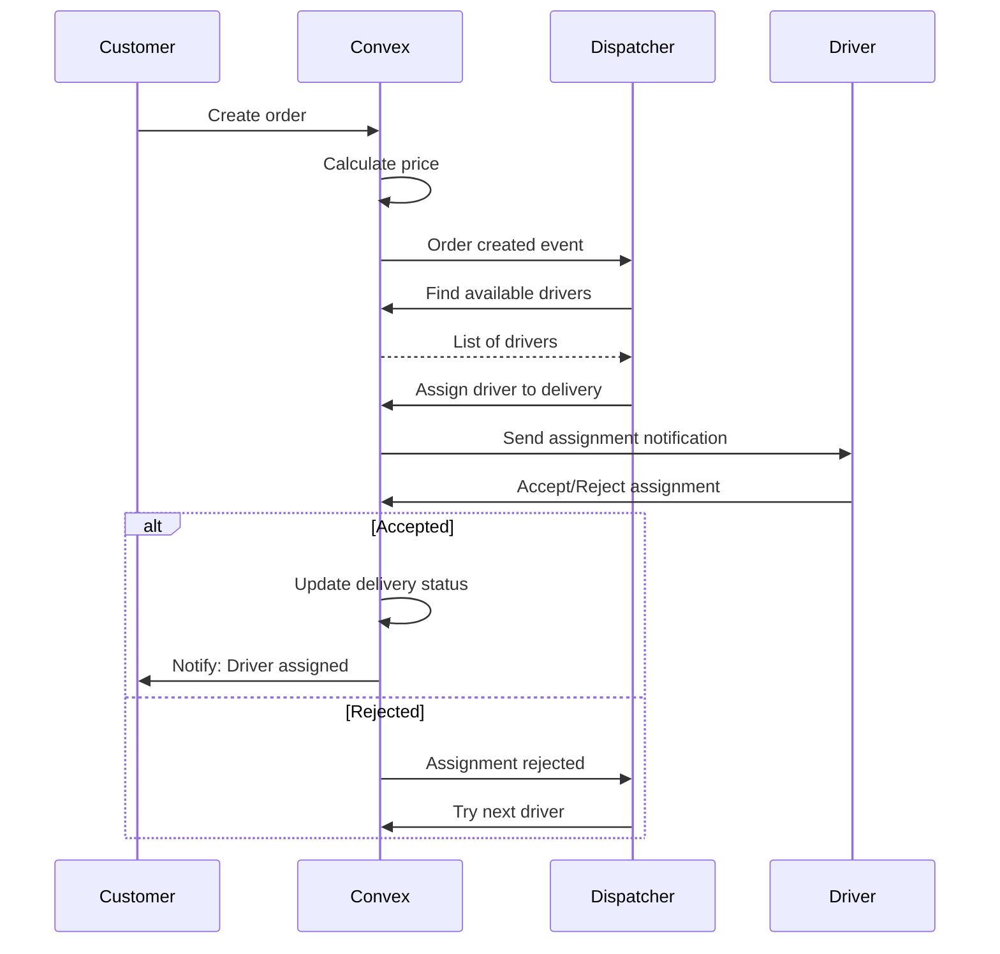

# Lasha Architecture — Vite + React + Convex

## System Overview



---

## 1. System Architecture

### 1.1 Technology Stack

| Layer | Technology | Purpose |
|-------|-----------|---------|
| Build | Vite 7 | Development server, HMR, production builds |
| UI | React 19 | Component rendering, state management |
| Routing | React Router 7 | Client-side navigation |
| Styling | Tailwind CSS 4 | Utility-first styling |
| Components | shadcn/ui + Radix | Accessible, composable UI primitives |
| Animation | Framer Motion | Page transitions, micro-interactions |
| Icons | Lucide React | Icon library |
| Backend | Convex | Database, serverless functions, real-time |
| Auth | @convex-dev/auth | Email OTP + Anonymous auth |
| Forms | React Hook Form + Zod | Form state, validation |
| Charts | Recharts | Data visualization |
| State | Convex queries (reactive) | Server state management |
| Local State | React useState/useReducer | UI-only state |

### 1.2 Architecture Principles

1. **Convex as Single Source of Truth** — All business data lives in Convex. React components are thin renderers.

2. **Domain-Oriented Module Boundaries** — Convex functions are organized by business domain, not by UI screens.

3. **Reactive by Default** — Use Convex subscriptions (queries) for real-time data. Avoid polling, manual refetching, or redundant client state.

4. **No Business Logic in React** — React handles rendering, user interaction, form state, and local UI state. All validation, authorization, state transitions, and business rules live in Convex.

5. **Actions for External Services** — Any external API call (email, SMS, payments, mapping) happens exclusively in Convex actions. Never call external APIs from React.

6. **Internal Functions for Cross-Domain Access** — Domain modules expose internal queries/mutations for other domains to consume. Public functions are for React only.

---

## 2. React Architecture

### 2.1 Application Structure

```
src/
├── main.tsx                    # App bootstrap, providers, routes
├── index.css                   # Global styles, Tailwind, CSS variables
├── components/
│   ├── RequireAuth.tsx         # Auth guard with dev bypass
│   ├── LogoDropdown.tsx        # Brand dropdown
│   ├── dashboard/              # Dashboard-specific components
│   │   ├── TopNavigation.tsx
│   │   ├── Sidebar.tsx
│   │   ├── OrderPanel.tsx
│   │   ├── OrderCard.tsx
│   │   ├── OrderFilters.tsx
│   │   ├── SearchBar.tsx
│   │   ├── DetailsPanel.tsx
│   │   ├── DetailTabs.tsx
│   │   ├── OrderDetailsTab.tsx
│   │   ├── VehiclePanel.tsx
│   │   ├── DriverDetailsTab.tsx
│   │   ├── CustomerDetailsTab.tsx
│   │   └── SpecificationCard.tsx
│   ├── lasha/                  # Landing page components
│   │   ├── Navbar.tsx
│   │   ├── Hero.tsx
│   │   ├── WhyLasha.tsx
│   │   ├── WhoWeServe.tsx
│   │   ├── HowItWorks.tsx
│   │   ├── About.tsx
│   │   ├── SectorIntelligence.tsx
│   │   ├── FAQ.tsx
│   │   ├── FinalCTA.tsx
│   │   └── Footer.tsx
│   └── ui/                     # shadcn/ui primitives (50+ components)
├── pages/
│   ├── Landing.tsx
│   ├── Auth.tsx
│   ├── Dashboard.tsx
│   ├── RequestDelivery.tsx
│   ├── TrackDelivery.tsx
│   ├── Wallet.tsx
│   ├── Settings.tsx
│   ├── PastDeliveries.tsx
│   ├── Invoices.tsx
│   ├── MakePayment.tsx
│   ├── Notifications.tsx
│   ├── Help.tsx
│   ├── Legal.tsx
│   ├── Downloads.tsx
│   └── NotFound.tsx
├── hooks/
│   ├── use-auth.ts             # Auth hook (Convex auth + user query)
│   ├── use-mobile.ts           # Responsive detection
│   └── useDashboardNav.ts      # Sidebar navigation + sign-out
├── data/
│   └── orders.ts               # MOCK DATA (to be replaced by Convex)
├── styles/
│   ├── dashboard.css
│   ├── pages.css
│   ├── request-delivery.css
│   ├── settings.css
│   ├── track-delivery.css
│   └── wallet.css
├── lib/
│   └── utils.ts                # cn() utility
├── types/
│   └── global.d.ts             # Global type declarations
└── convex/                     # Backend (see Convex Architecture)
```

### 2.2 Route Architecture

```
/                    → Landing (public)
/auth                → Auth page (public, redirect if authenticated)
/dashboard           → Activity Center (protected)
/request-delivery    → Delivery request form (protected)
/track-delivery      → Tracking lookup (protected)
/wallet              → Wallet & transactions (protected)
/settings            → Account settings (protected)
/past-deliveries     → Order history (protected)
/invoices            → Invoice management (protected)
/make-payment        → Payment flow (protected)
/notifications       → Notification center (protected)
/help                → Help center (protected)
/legal               → Legal documents (protected)
/downloads           → Document downloads (protected)
*                    → 404 page
```

### 2.3 Auth Guard Pattern

```tsx
// RequireAuth.tsx — Guards protected routes
// Supports dev bypass via ?dev=true or ?guest=true URL params
// Falls back to session-level bypass via sessionStorage("lasha_guest")
// On unauthenticated access, redirects to /auth?returnTo={currentPath}
```

### 2.4 Component Responsibilities

| Component | Responsibility | State Source |
|-----------|---------------|--------------|
| Dashboard | Layout orchestration, order selection | Local useState + Convex queries |
| OrderPanel | List filtering, search, selection | Local filter state + Convex query |
| DetailsPanel | Order detail display, tab switching | Local tab state + Convex query |
| Sidebar | Navigation, sign-out | Local active state + route |
| RequestDelivery | Form state, validation | Local form state (React Hook Form) |
| TrackDelivery | Tracking lookup, display | Local input + Convex query |
| Wallet | Balance, transactions, top-up | Convex queries + local modal state |
| Settings | Profile, business, notifications, security | Convex queries + local form state |

### 2.5 Data Flow Pattern

```
User Action → React Event Handler → Convex Mutation
                                         ↓
                                    Convex Database
                                         ↓
                                    Convex Query (subscription)
                                         ↓
                                    React Re-render (automatic)
```

---

## 3. Convex Architecture

### 3.1 Directory Structure

```
src/convex/
├── auth/                      # Authentication providers
│   └── emailOtp.ts            # Email OTP provider
├── auth.config.ts             # Auth configuration (Convex + VLY)
├── auth.ts                    # Convex auth setup
├── http.ts                    # HTTP router (auth routes)
├── schema.ts                  # Database schema (source of truth)
├── users.ts                   # User queries
├── _generated/                # Auto-generated types (DO NOT EDIT)
│   ├── api.d.ts
│   ├── server.d.ts
│   └── dataModel.d.ts
│
├── domains/                   # Domain modules
│   ├── users/
│   │   ├── queries.ts         # Public: getCurrentUser, getUserProfile
│   │   ├── mutations.ts       # Public: updateProfile, updateSettings
│   │   └── internal.ts        # Internal: getUserById (for other domains)
│   │
│   ├── companies/
│   │   ├── queries.ts         # Public: getCompany, getCompanyMembers
│   │   ├── mutations.ts       # Public: createCompany, updateCompany
│   │   └── internal.ts        # Internal: getCompanyByOwner
│   │
│   ├── addresses/
│   │   ├── queries.ts         # Public: getUserAddresses
│   │   ├── mutations.ts       # Public: addAddress, updateAddress, deleteAddress
│   │   └── internal.ts        # Internal: getAddressById
│   │
│   ├── orders/
│   │   ├── queries.ts         # Public: getOrder, getUserOrders, getBusinessOrders
│   │   ├── mutations.ts       # Public: createOrder, cancelOrder
│   │   ├── internal.ts        # Internal: getOrderForDispatch, updateOrderStatus
│   │   └── validators.ts      # Shared validators for orders
│   │
│   ├── deliveries/
│   │   ├── queries.ts         # Public: getDelivery, getOrderDeliveries
│   │   ├── mutations.ts       # Public: None (dispatch handles assignment)
│   │   ├── internal.ts        # Internal: createDelivery, assignCourier, updateDeliveryStatus
│   │   └── validators.ts      # Delivery status transitions
│   │
│   ├── drivers/
│   │   ├── queries.ts         # Public: getDriverProfile, getAvailableDrivers
│   │   ├── mutations.ts       # Public: updateAvailability, updateLocation
│   │   ├── internal.ts        # Internal: getDriverById, incrementDriverStats
│   │   └── validators.ts      # Driver availability rules
│   │
│   ├── vehicles/
│   │   ├── queries.ts         # Public: getVehicle, getDriverVehicles
│   │   ├── mutations.ts       # Public: addVehicle, updateVehicle
│   │   ├── internal.ts        # Internal: getVehicleById, checkVehicleCapacity
│   │   └── validators.ts      # Vehicle validation rules
│   │
│   ├── dispatch/
│   │   ├── queries.ts         # Public: getActiveDispatches
│   │   ├── mutations.ts       # Public: None
│   │   ├── actions.ts         # Actions: dispatchDelivery (external API calls)
│   │   └── internal.ts        # Internal: assignDriverToDelivery, cancelDispatch
│   │
│   ├── trips/
│   │   ├── queries.ts         # Public: getTrip, getTripHistory
│   │   ├── mutations.ts       # Public: None
│   │   ├── internal.ts        # Internal: startTrip, completeTrip, addTripEvent
│   │   └── validators.ts      # Trip status transitions
│   │
│   ├── tracking/
│   │   ├── queries.ts         # Public: getDeliveryTracking, getLocationHistory
│   │   ├── mutations.ts       # Public: reportLocation (driver app)
│   │   ├── internal.ts        # Internal: saveLocationUpdate
│   │   └── validators.ts      # Location validation
│   │
│   ├── pricing/
│   │   ├── queries.ts         # Public: getDeliveryQuote
│   │   ├── mutations.ts       # Public: None
│   │   ├── actions.ts         # Actions: calculatePrice (external factors)
│   │   └── internal.ts        # Internal: applyPricingRules
│   │
│   ├── proofOfDelivery/
│   │   ├── queries.ts         # Public: getProofOfDelivery
│   │   ├── mutations.ts       # Public: submitProofOfDelivery
│   │   ├── actions.ts         # Actions: uploadDeliveryPhoto
│   │   └── internal.ts        # Internal: verifyProofOfDelivery
│   │
│   ├── notifications/
│   │   ├── queries.ts         # Public: getUserNotifications, getUnreadCount
│   │   ├── mutations.ts       # Public: markAsRead, markAllRead
│   │   ├── actions.ts         # Actions: sendPushNotification, sendSMS
│   │   └── internal.ts        # Internal: createNotification
│   │
│   ├── payments/
│   │   ├── queries.ts         # Public: getWalletBalance, getTransactions
│   │   ├── mutations.ts       # Public: topUpWallet, requestWithdrawal
│   │   ├── actions.ts         # Actions: processPayment, processRefund
│   │   └── internal.ts        # Internal: debitWallet, creditWallet, settleDriver
│   │
│   ├── invoices/
│   │   ├── queries.ts         # Public: getInvoices, getInvoice
│   │   ├── mutations.ts       # Public: generateInvoice
│   │   ├── internal.ts        # Internal: createInvoiceForOrder
│   │   └── validators.ts      # Invoice validation
│   │
│   └── shared/
│       ├── utils.ts           # Shared utilities (formatting, validation)
│       ├── constants.ts       # Shared constants (statuses, limits)
│       └── validators.ts      # Shared validators (pagination, date ranges)
│
└── index.ts                   # Re-exports all public functions
```

### 3.2 Function Types and Rules

| Function Type | Prefix | Access | Use Case |
|--------------|--------|--------|----------|
| `query` | Public | React can call | Data fetching for UI |
| `mutation` | Public | React can call | Data modification from UI |
| `action` | Public | React can call | External API calls, complex logic |
| `httpAction` | Public | HTTP endpoints | Webhooks, third-party callbacks |
| `internalQuery` | Internal | Other functions only | Cross-domain data access |
| `internalMutation` | Internal | Other functions only | Cross-domain data modification |
| `internalAction` | Internal | Other functions only | Cross-domain external calls |

### 3.3 Naming Conventions

```typescript
// Queries — verb + noun, lowercase camelCase
export const getOrder = query({ ... });
export const getUserOrders = query({ ... });
export const getActiveDispatches = query({ ... });

// Mutations — verb + noun
export const createOrder = mutation({ ... });
export const updateOrderStatus = mutation({ ... });
export const cancelOrder = mutation({ ... });

// Actions — verb + noun (often with "via" or "through")
export const processPaymentViaPaystack = action({ ... });
export const sendDeliveryNotification = action({ ... });
export const calculateDistanceMatrix = action({ ... });

// Internal — same pattern, used for cross-domain calls
export const getOrderByDeliveryId = internalQuery({ ... });
export const assignDriverToDelivery = internalMutation({ ... });
```

---

## 4. Domain Boundaries

### 4.1 Domain Dependency Rules

```
┌─────────────────────────────────────────────────────────┐
│                    SHARED DOMAIN                        │
│                  (validators, utils)                    │
└─────────────────────────────────────────────────────────┘
                           ↑
┌──────────┬──────────┬──────────┬──────────┬──────────┐
│  USERS   │COMPANIES │ADDRESSES │ VEHICLES │ DRIVERS  │
└──────────┴──────────┴──────────┴──────────┴──────────┘
                           ↑
┌─────────────────────────────────────────────────────────┐
│                    ORDERS DOMAIN                       │
│          (depends on: users, companies, addresses)     │
└─────────────────────────────────────────────────────────┘
                           ↑
┌─────────────────────────────────────────────────────────┐
│                   DELIVERIES DOMAIN                    │
│          (depends on: orders, drivers, vehicles)       │
└─────────────────────────────────────────────────────────┘
                           ↑
┌─────────────┬─────────────┬─────────────┬─────────────┐
│   DISPATCH  │    TRIPS    │   TRACKING  │   PRICING   │
│(deliveries) │(deliveries) │ (deliveries) │  (orders)   │
└─────────────┴─────────────┴─────────────┴─────────────┘
                           ↑
┌─────────────┬─────────────┬─────────────┬─────────────┐
│    PROOF    │NOTIFICATIONS│   PAYMENTS  │   INVOICES  │
│ OF DELIVERY │  (orders,   │  (orders,   │  (orders,   │
│ (deliveries)│  users)     │  users)     │  companies) │
└─────────────┴─────────────┴─────────────┴─────────────┘
```

### 4.2 Allowed Dependencies

| Domain | Can Import From |
|--------|-----------------|
| shared | (none — leaf node) |
| users | shared |
| companies | shared, users |
| addresses | shared, users |
| vehicles | shared |
| drivers | shared, users, vehicles |
| orders | shared, users, companies, addresses |
| deliveries | shared, orders, drivers, vehicles |
| dispatch | shared, deliveries, drivers, vehicles, orders |
| trips | shared, deliveries, drivers, vehicles |
| tracking | shared, deliveries, drivers |
| pricing | shared, orders, deliveries |
| proofOfDelivery | shared, deliveries, orders |
| notifications | shared, orders, users, deliveries |
| payments | shared, orders, users, companies |
| invoices | shared, orders, companies |

### 4.3 Forbidden Patterns

1. **No circular dependencies** — Domain A cannot import from Domain B if Domain B imports from Domain A.

2. **No direct table access across domains** — Always use internal queries/mutations. Never write `ctx.db.query("orders")` from the `drivers` domain.

3. **No React in Convex** — Convex functions are server-side only. Never import React components or hooks.

4. **No external calls in queries/mutations** — All HTTP requests to external services must happen in actions.

5. **No business logic in React** — Form validation can exist in React for UX, but authoritative validation must also exist in Convex mutations.

---

## 5. Data Ownership

### 5.1 Primary Data Owners

| Domain | Owns Tables | Description |
|--------|------------|-------------|
| users | `users` | User profiles, auth data |
| companies | `businesses` | Business accounts |
| addresses | `addresses` | Saved delivery locations |
| orders | `orders` | Customer shipment requests |
| deliveries | `deliveries` | Courier assignments, delivery tracking |
| drivers | `drivers` | Driver profiles, availability, location |
| vehicles | `vehicles` | Fleet vehicles, capacity, specs |
| trips | `trips`, `trip_events` | Trip lifecycle, events |
| proofOfDelivery | `proof_of_delivery` | Photos, signatures, confirmation |
| pricing | `pricing_rules`, `delivery_quotes` | Pricing logic, quotes |
| payments | `wallets`, `transactions`, `driver_earnings` | Financial operations |
| invoices | `invoices` | Billing documents |
| notifications | `notifications` | User notifications |
| audit | `audit_logs` | System audit trail |

### 5.2 Cross-Domain Data Access

```typescript
// CORRECT: Use internal query
// In dispatch/queries.ts
const delivery = await ctx.runQuery(
  api.domains.deliveries.internal.getDeliveryById,
  { deliveryId }
);

// WRONG: Direct table access
// Never do this from a different domain
const delivery = await ctx.db.get(deliveryId); // ❌
```

---

## 6. Query/Mutation/Action Rules

### 6.1 When to Use Each

```
QUERY (read data, reactive subscription)
├── UI needs to display data
├── Data should update in real-time
├── No side effects
└── Example: getUserOrders, getOrder, getWalletBalance

MUTATION (write data, atomic operation)
├── User is modifying application state
├── Must be idempotent where possible
├── Should validate inputs
├── Should check authorization
└── Example: createOrder, cancelOrder, updateProfile

ACTION (complex logic, external calls)
├── Need to call external APIs
├── Need to orchestrate multiple mutations
├── Need to process data asynchronously
├── May have side effects (send email, SMS)
└── Example: processPayment, sendNotification, calculateRoute

INTERNAL QUERY/MUTATION (cross-domain)
├── One domain needs data from another domain
├── Encapsulates domain logic
├── Not exposed to React
└── Example: getOrderForDispatch, assignDriverToDelivery
```

### 6.2 Query Patterns

```typescript
// Simple read
export const getOrder = query({
  args: { orderId: v.id("orders") },
  handler: async (ctx, args) => {
    const order = await ctx.db.get(args.orderId);
    if (!order) throw new Error("Order not found");
    // Authorization check
    const userId = await getAuthUserId(ctx);
    if (order.senderId !== userId) throw new Error("Unauthorized");
    return order;
  },
});

// List with filtering
export const getUserOrders = query({
  args: {
    status: v.optional(orderStatusValidator),
    limit: v.optional(v.number()),
  },
  handler: async (ctx, args) => {
    const userId = await getAuthUserId(ctx);
    if (!userId) throw new Error("Not authenticated");
    
    let query = ctx.db
      .query("orders")
      .withIndex("by_sender", (q) => q.eq("senderId", userId));
    
    if (args.status) {
      query = query.filter((q) => q.eq(q.field("status"), args.status));
    }
    
    return await query.order("desc").take(args.limit ?? 50);
  },
});

// Aggregation
export const getWalletBalance = query({
  args: {},
  handler: async (ctx) => {
    const userId = await getAuthUserId(ctx);
    if (!userId) throw new Error("Not authenticated");
    
    const wallet = await ctx.db
      .query("wallets")
      .withIndex("by_user", (q) => q.eq("userId", userId))
      .unique();
    
    return wallet?.balance ?? 0;
  },
});
```

### 6.3 Mutation Patterns

```typescript
// Create with validation
export const createOrder = mutation({
  args: {
    pickupAddressId: v.id("addresses"),
    dropoffAddressId: v.id("addresses"),
    description: v.string(),
    packageSize: v.union(v.literal("small"), v.literal("medium"), v.literal("large")),
    scheduledTime: v.optional(v.number()),
  },
  handler: async (ctx, args) => {
    const userId = await getAuthUserId(ctx);
    if (!userId) throw new Error("Not authenticated");
    
    // Validate addresses belong to user
    const pickup = await ctx.db.get(args.pickupAddressId);
    const dropoff = await ctx.db.get(args.dropoffAddressId);
    if (!pickup || !dropoff) throw new Error("Invalid address");
    if (pickup.userId !== userId || dropoff.userId !== userId) {
      throw new Error("Unauthorized");
    }
    
    // Calculate price
    const price = await ctx.runQuery(
      api.domains.pricing.internal.calculatePrice,
      { pickup, dropoff, packageSize: args.packageSize }
    );
    
    // Create order
    const orderId = await ctx.db.insert("orders", {
      senderId: userId,
      pickupAddressId: args.pickupAddressId,
      dropoffAddressId: args.dropoffAddressId,
      status: "pending",
      description: args.description,
      packageSize: args.packageSize,
      price,
      scheduledTime: args.scheduledTime,
      createdAt: Date.now(),
      updatedAt: Date.now(),
    });
    
    return orderId;
  },
});

// Status transition with validation
export const cancelOrder = mutation({
  args: { orderId: v.id("orders") },
  handler: async (ctx, args) => {
    const userId = await getAuthUserId(ctx);
    const order = await ctx.db.get(args.orderId);
    
    if (!order) throw new Error("Order not found");
    if (order.senderId !== userId) throw new Error("Unauthorized");
    if (order.status !== "pending") {
      throw new Error("Cannot cancel order in current status");
    }
    
    await ctx.db.patch(args.orderId, {
      status: "cancelled",
      updatedAt: Date.now(),
    });
    
    // Create audit log
    await ctx.runMutation(
      api.domains.audit.internal.logAction,
      { action: "order_cancelled", entityId: args.orderId, userId }
    );
    
    return { success: true };
  },
});
```

### 6.4 Action Patterns

```typescript
// External API call
export const processPayment = action({
  args: {
    orderId: v.id("orders"),
    paymentMethod: v.string(),
  },
  handler: async (ctx, args) => {
    const order = await ctx.runQuery(
      api.domains.orders.internal.getOrderById,
      { orderId: args.orderId }
    );
    
    // Call external payment gateway
    const response = await fetch("https://api.paystack.co/transaction/initialize", {
      method: "POST",
      headers: {
        Authorization: `Bearer ${process.env.PAYSTACK_SECRET_KEY}`,
        "Content-Type": "application/json",
      },
      body: JSON.stringify({
        email: order.customerEmail,
        amount: order.price * 100, // Paystack uses kobo
        reference: `LASHA-${order._id}`,
      }),
    });
    
    const data = await response.json();
    
    // Record transaction
    await ctx.runMutation(
      api.domains.payments.internal.recordTransaction,
      {
        orderId: args.orderId,
        amount: order.price,
        reference: data.data.reference,
        status: "pending",
      }
    );
    
    return { authorizationUrl: data.data.authorization_url };
  },
});

// Orchestrate multiple mutations
export const completeDelivery = action({
  args: { deliveryId: v.id("deliveries") },
  handler: async (ctx, args) => {
    // 1. Update delivery status
    await ctx.runMutation(
      api.domains.deliveries.internal.updateDeliveryStatus,
      { deliveryId: args.deliveryId, status: "delivered" }
    );
    
    // 2. Complete trip
    const trip = await ctx.runQuery(
      api.domains.trips.internal.getTripByDelivery,
      { deliveryId: args.deliveryId }
    );
    if (trip) {
      await ctx.runMutation(
        api.domains.trips.internal.completeTrip,
        { tripId: trip._id }
      );
    }
    
    // 3. Process driver payment
    await ctx.runMutation(
      api.domains.payments.internal.settleDriverEarnings,
      { deliveryId: args.deliveryId }
    );
    
    // 4. Send notification to customer
    const delivery = await ctx.runQuery(
      api.domains.deliveries.internal.getDeliveryById,
      { deliveryId: args.deliveryId }
    );
    await ctx.runMutation(
      api.domains.notifications.internal.createNotification,
      {
        userId: delivery.customerId,
        type: "delivery_completed",
        title: "Delivery Complete",
        message: "Your package has been delivered!",
        entityId: args.deliveryId,
      }
    );
    
    // 5. Create audit log
    await ctx.runMutation(
      api.domains.audit.internal.logAction,
      {
        action: "delivery_completed",
        entityId: args.deliveryId,
        details: { completedAt: Date.now() },
      }
    );
    
    return { success: true };
  },
});
```

---

## 7. Authentication Architecture

### 7.1 Auth Flow



### 7.2 Auth Providers

1. **Email OTP** — Primary authentication method. 6-digit code sent via `auth.freebuff.app`.

2. **Anonymous** — Guest access for demo/preview. Limited functionality.

3. **VLY Convex JWT** — Federated auth for Freebuff platform integration.

### 7.3 Auth Configuration

```typescript
// convex/auth.config.ts
{
  providers: [
    // Project's own auth (self-issued JWTs)
    { domain: CONVEX_SITE_URL, applicationID: "convex" },
    // Freebuff federated auth
    { type: "customJwt", issuer: "https://freebuff.com", ... }
  ]
}
```

### 7.4 Auth Guard Pattern

```typescript
// In every query/mutation that requires auth:
const userId = await getAuthUserId(ctx);
if (!userId) throw new Error("Not authenticated");

// In React:
const { isAuthenticated, user } = useAuth();
if (!isAuthenticated) return <Navigate to="/auth" />;
```

### 7.5 Guest/Dev Bypass

```typescript
// RequireAuth.tsx supports:
// 1. URL params: ?dev=true or ?guest=true
// 2. Session storage: sessionStorage("lasha_guest") === "true"
// Bypasses auth check for development/testing
```

---

## 8. Authorization Architecture

### 8.1 Role-Based Access Control

```typescript
// Schema defines roles:
export const ROLES = {
  ADMIN: "admin",      // Full system access
  USER: "user",        // Basic customer
  MEMBER: "member",    // Team member within a business
  BUSINESS: "business", // Business account owner
  COURIER: "courier",  // Driver/delivery person
};
```

### 8.2 Authorization Rules

| Action | Allowed Roles | Additional Checks |
|--------|---------------|-------------------|
| Create order | user, business, member | Must own the addresses |
| View order | user, business, member, admin | Must be sender or business member |
| Cancel order | user, business, member, admin | Order must be in "pending" status |
| Assign driver | admin, dispatch | Driver must be available |
| Update delivery status | courier (own delivery), admin | Valid status transition |
| View wallet | user, business | Own wallet only |
| Top up wallet | user, business | Valid payment method |
| View invoices | business | Own company invoices only |
| Manage settings | user, business | Own profile only |
| View all orders | admin | No restriction |
| Manage drivers | admin | No restriction |
| Manage vehicles | admin | No restriction |

### 8.3 Authorization Implementation

```typescript
// Utility function for common auth check
async function requireAuth(ctx: QueryCtx | MutationCtx) {
  const userId = await getAuthUserId(ctx);
  if (!userId) throw new Error("Not authenticated");
  return userId;
}

// Utility for role check
async function requireRole(ctx: QueryCtx | MutationCtx, ...roles: Role[]) {
  const userId = await requireAuth(ctx);
  const user = await ctx.db.get(userId);
  if (!user || !roles.includes(user.role as Role)) {
    throw new Error("Unauthorized");
  }
  return userId;
}

// Usage in queries/mutations
export const adminGetAllOrders = query({
  args: {},
  handler: async (ctx) => {
    const userId = await requireRole(ctx, "admin");
    return await ctx.db.query("orders").collect();
  },
});
```

---

## 9. Real-Time Architecture

### 9.1 Convex Reactive Queries

```typescript
// In React — automatic real-time updates
const orders = useQuery(api.domains.orders.queries.getUserOrders, {
  status: "in_transit",
});
// Automatically re-renders when orders change in database

// In React — single item subscription
const order = useQuery(api.domains.orders.queries.getOrder, {
  orderId: selectedOrderId,
});
// Automatically updates when this specific order changes
```

### 9.2 Real-Time Use Cases

| Feature | Real-Time Mechanism | Update Frequency |
|---------|--------------------|--------------------|
| Order status | Convex query subscription | On status change |
| Driver location | Convex query subscription | Every 5-10 seconds |
| Delivery tracking | Convex query subscription | On location update |
| Notifications | Convex query subscription | On new notification |
| Wallet balance | Convex query subscription | On transaction |
| Active dispatches | Convex query subscription | On dispatch change |

### 9.3 Location Updates (Driver)

```typescript
// Driver reports location (called from driver app)
export const reportLocation = mutation({
  args: {
    lat: v.number(),
    lng: v.number(),
    deliveryId: v.optional(v.id("deliveries")),
  },
  handler: async (ctx, args) => {
    const userId = await requireRole(ctx, "courier");
    
    // Update driver's current location (Redis-like ephemeral state via document)
    await ctx.db.patch(userId, {
      currentLat: args.lat,
      currentLng: args.lng,
      lastLocationUpdate: Date.now(),
    });
    
    // If on active delivery, record location event
    if (args.deliveryId) {
      const trip = await ctx.runQuery(
        api.domains.trips.internal.getTripByDelivery,
        { deliveryId: args.deliveryId }
      );
      if (trip) {
        await ctx.runMutation(
          api.domains.trips.internal.addTripEvent,
          {
            tripId: trip._id,
            type: "location_update",
            lat: args.lat,
            lng: args.lng,
          }
        );
      }
    }
    
    return { success: true };
  },
});
```

---

## 10. Dispatch Architecture

### 10.1 Dispatch Flow



### 10.2 Driver Assignment Logic

```typescript
// Internal mutation for driver assignment
export const assignDriverToDelivery = internalMutation({
  args: {
    deliveryId: v.id("deliveries"),
    driverId: v.id("users"),
  },
  handler: async (ctx, args) => {
    // 1. Check driver availability
    const driver = await ctx.runQuery(
      api.domains.drivers.internal.getDriverById,
      { driverId: args.driverId }
    );
    if (!driver.isAvailable) throw new Error("Driver not available");
    
    // 2. Check vehicle capacity
    const vehicle = await ctx.runQuery(
      api.domains.vehicles.internal.getVehicleById,
      { vehicleId: driver.vehicleId }
    );
    const order = await ctx.runQuery(
      api.domains.orders.internal.getOrderForDelivery,
      { deliveryId: args.deliveryId }
    );
    if (vehicle.capacity < order.weight) {
      throw new Error("Vehicle capacity insufficient");
    }
    
    // 3. Assign delivery
    await ctx.db.patch(args.deliveryId, {
      courierId: args.driverId,
      status: "confirmed",
    });
    
    // 4. Mark driver as unavailable
    await ctx.db.patch(args.driverId, {
      isAvailable: false,
    });
    
    // 5. Create trip
    await ctx.runMutation(
      api.domains.trips.internal.createTrip,
      {
        deliveryId: args.deliveryId,
        driverId: args.driverId,
        vehicleId: driver.vehicleId,
      }
    );
    
    // 6. Log audit
    await ctx.runMutation(
      api.domains.audit.internal.logAction,
      {
        action: "driver_assigned",
        entityId: args.deliveryId,
        details: { driverId: args.driverId },
      }
    );
    
    return { success: true };
  },
});
```

---

## 11. Tracking Architecture

### 11.1 Tracking Data Model

```typescript
// Deliveries table tracks current state
{
  _id: "delivery_id",
  orderId: "order_id",
  courierId: "driver_id",
  status: "in_transit",
  pickupLat: -26.2041,
  pickupLng: 28.0473,
  dropoffLat: -26.1367,
  dropoffLng: 28.0433,
  estimatedArrival: 1690000000,
  startedAt: 1689990000,
}

// Trips table tracks trip lifecycle
{
  _id: "trip_id",
  deliveryId: "delivery_id",
  driverId: "driver_id",
  vehicleId: "vehicle_id",
  status: "in_progress",
  startedAt: 1689990000,
  completedAt: null,
}

// Trip Events table tracks granular updates
{
  _id: "event_id",
  tripId: "trip_id",
  type: "location_update", // or "status_change", "arrival", etc.
  lat: -26.19,
  lng: 28.04,
  timestamp: 1689995000,
}
```

### 11.2 Tracking Queries

```typescript
// Get real-time tracking for customer
export const getDeliveryTracking = query({
  args: { trackingId: v.string() },
  handler: async (ctx, args) => {
    // Look up delivery by tracking ID
    const delivery = await ctx.runQuery(
      api.domains.deliveries.internal.getDeliveryByTrackingId,
      { trackingId: args.trackingId }
    );
    if (!delivery) throw new Error("Delivery not found");
    
    // Get latest trip events
    const events = await ctx.db
      .query("trip_events")
      .withIndex("by_trip", (q) => q.eq("tripId", delivery.tripId))
      .order("desc")
      .take(100);
    
    // Get driver info
    const driver = delivery.courierId
      ? await ctx.runQuery(
          api.domains.drivers.internal.getDriverById,
          { driverId: delivery.courierId }
        )
      : null;
    
    return {
      delivery,
      events,
      driver,
      lastLocation: events[0],
    };
  },
});
```

---

## 12. External Service Architecture

### 12.1 External Services Map

| Service | Purpose | Integration Point |
|---------|---------|-------------------|
| Email OTP (auth.freebuff.app) | Send verification codes | Auth provider |
| Paystack | Payment processing | Payments action |
| Google Maps API | Geocoding, routing, distance | Pricing action, Dispatch action |
| SMS Gateway | Delivery notifications | Notifications action |
| Push Notifications | Real-time alerts | Notifications action |
| File Storage (Convex) | POD photos, signatures | ProofOfDelivery action |

### 12.2 External Call Pattern

```typescript
// ALWAYS through Convex actions, never from React
export const calculateRoute = action({
  args: {
    pickup: v.object({ lat: v.number(), lng: v.number() }),
    dropoff: v.object({ lat: v.number(), lng: v.number() }),
  },
  handler: async (ctx, args) => {
    const apiKey = process.env.GOOGLE_MAPS_API_KEY;
    const response = await fetch(
      `https://maps.googleapis.com/maps/api/directions/json?` +
      `origin=${args.pickup.lat},${args.pickup.lng}` +
      `&destination=${args.dropoff.lat},${args.dropoff.lng}` +
      `&key=${apiKey}`
    );
    const data = await response.json();
    return {
      distance: data.routes[0].legs[0].distance.value,
      duration: data.routes[0].legs[0].duration.value,
      polyline: data.routes[0].overview_polyline.points,
    };
  },
});
```

### 12.3 Environment Variables (Convex Actions)

```typescript
// Process env in Convex actions:
process.env.PAYSTACK_SECRET_KEY
process.env.GOOGLE_MAPS_API_KEY
process.env.SMS_GATEWAY_KEY
process.env.VLY_APP_NAME
```

**Note:** Never log or expose secrets. Never use secrets in queries or mutations (only in actions).

---

## 13. Error Handling Strategy

### 13.1 Error Types

```typescript
// Convex functions should throw descriptive errors
throw new Error("Order not found");
throw new Error("Unauthorized");
throw new Error("Cannot cancel order in current status");
throw new Error("Invalid address");
throw new Error("Payment processing failed");
```

### 13.2 React Error Handling

```typescript
// In React components:
const order = useQuery(api.orders.getOrder, { orderId });
// Convex returns undefined while loading, null if error
// Handle loading state with skeletons
// Handle error state with error messages

// For mutations:
const createOrder = useMutation(api.orders.createOrder);
try {
  await createOrder({ ... });
  // Success
} catch (error) {
  // Show error toast
  toast.error(error.message);
}
```

### 13.3 Error Boundaries

```typescript
// main.tsx has RootErrorBoundary
// Catches any unhandled React errors
// Shows error message instead of blank page

// VlyToolbar has ToolbarErrorBoundary
// Isolates toolbar errors from main app
```

---

## 14. Offline Strategy

### 14.1 Current State

The application requires network connectivity. Convex handles:
- Automatic reconnection
- Optimistic updates (configurable)
- Offline queue for mutations (Convex SDK feature)

### 14.2 Offline Considerations

1. **Reads** — Convex queries return cached data when offline
2. **Writes** — Mutations queue and sync when online
3. **Real-time** — Suspended when offline, resumes on reconnect
4. **Actions** — Will fail if external APIs unreachable

### 14.3 Future Enhancement

For full offline support:
- Implement Convex offline configuration
- Cache critical data in IndexedDB
- Queue critical mutations
- Show connectivity status in UI

---

## 15. Testing Strategy

### 15.1 Unit Testing

```typescript
// Test Convex functions with Convex test utilities
// Test React components with React Testing Library
// Test form validation with Zod schemas
```

### 15.2 Integration Testing

```typescript
// Test full flows:
// 1. Create order → Assign driver → Complete delivery
// 2. Auth flow → Login → Access protected route
// 3. Payment flow → Top up wallet → Pay for delivery
```

### 15.3 E2E Testing

```typescript
// Playwright/Cypress for critical user journeys
// 1. Landing page → Auth → Dashboard → Create order
// 2. Track delivery → View status → Contact driver
```

---

## 16. Deployment Architecture

### 16.1 Development

```
Local Machine
├── Vite Dev Server (port 5173)
├── Convex Dev Server (convex dev)
└── HMR enabled
```

### 16.2 Production

```
Freebuff Platform
├── Vite Build → Static Assets
├── Convex Cloud (serverless functions + database)
├── CDN (static assets)
└── Managed by Freebuff infrastructure
```

### 16.3 Environment Variables

| Variable | Location | Purpose |
|----------|----------|---------|
| `VITE_CONVEX_URL` | Client (.env) | Convex deployment URL |
| `CONVEX_SITE_URL` | Convex (env) | Auth issuer URL |
| `PAYSTACK_SECRET_KEY` | Convex (env) | Payment gateway |
| `GOOGLE_MAPS_API_KEY` | Convex (env) | Mapping services |
| `VLY_APP_NAME` | Convex (env) | App identifier |
| `VLY_INTEGRATION_KEY` | Client | VLY integrations |

---

## 17. Security Architecture

### 17.1 Security Layers

1. **Auth Layer** — Convex Auth handles JWT validation, session management
2. **Function Level** — Every query/mutation checks `getAuthUserId()`
3. **Data Level** — Users can only access their own data (enforced in handlers)
4. **External Calls** — Secrets only in actions, never exposed to client
5. **Input Validation** — Zod validators in schema and function args

### 17.2 Security Rules

1. **Never trust client input** — Validate everything in Convex
2. **Least privilege** — Users access only what they need
3. **No secrets in client** — All API keys in Convex env
4. **Audit sensitive operations** — Log all state changes
5. **Rate limiting** — Implement for public endpoints (future)

### 17.3 Data Protection

- Passwords: Not used (OTP auth)
- PII: Encrypted at rest (Convex default)
- Financial data: PCI compliant via Paystack
- Location data: Accessible only to assigned parties

---

## 18. Future Scaling Strategy

### 18.1 Phase 1: MVP (Current)

- Basic order management
- Simple driver assignment
- Wallet + payments
- Email notifications

### 18.2 Phase 2: Growth

- Real-time tracking with map
- Automated dispatch algorithm
- Multi-business support
- SMS notifications
- Invoice generation

### 18.3 Phase 3: Scale

- Advanced analytics dashboard
- Route optimization
- Fleet management
- API for third-party integrations
- Mobile app (React Native)

### 18.4 Convex Scaling Considerations

1. **Database** — Convex handles horizontal scaling automatically
2. **Functions** — Serverless, scales with demand
3. **Real-time** — Convex manages WebSocket connections
4. **File Storage** — Convex handles uploads/downloads
5. **Rate Limiting** — Implement for public APIs
6. **Caching** — Convex handles query caching

### 18.5 Extraction Points (If Needed)

If scale requires microservices:
- **Dispatch Service** — Extract from dispatch domain
- **Pricing Service** — Extract from pricing domain
- **Analytics Service** — Extract from analytics domain
- **Notification Service** — Extract from notifications domain

Each domain is designed to be extractable without changing the interface.

---

## Summary

Lasha is architected as a **Vite + React + Convex** application with:

1. **React** — Thin UI layer, handles rendering and user interaction
2. **Convex** — Single source of truth for all business logic, data, and real-time updates
3. **Domain Modules** — Clean separation of concerns within Convex
4. **Internal Functions** — Controlled cross-domain access
5. **Actions** — Isolated external service integrations
6. **Auth** — Email OTP + Anonymous with role-based access control

The architecture prioritizes:
- Simplicity over complexity
- Convex primitives over custom solutions
- Real-time reactivity over polling
- Server-side logic over client-side
- Domain boundaries over flat structure

This design scales from MVP to production while maintaining code quality and allowing future extraction of individual domains if scale demands it.
