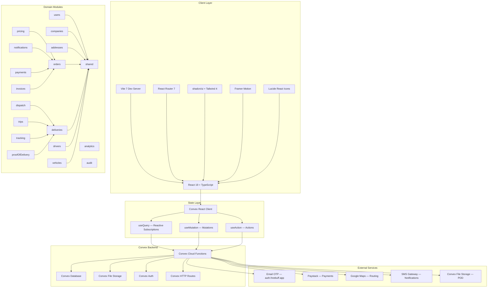
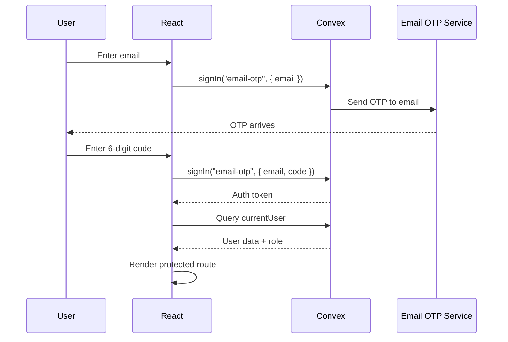
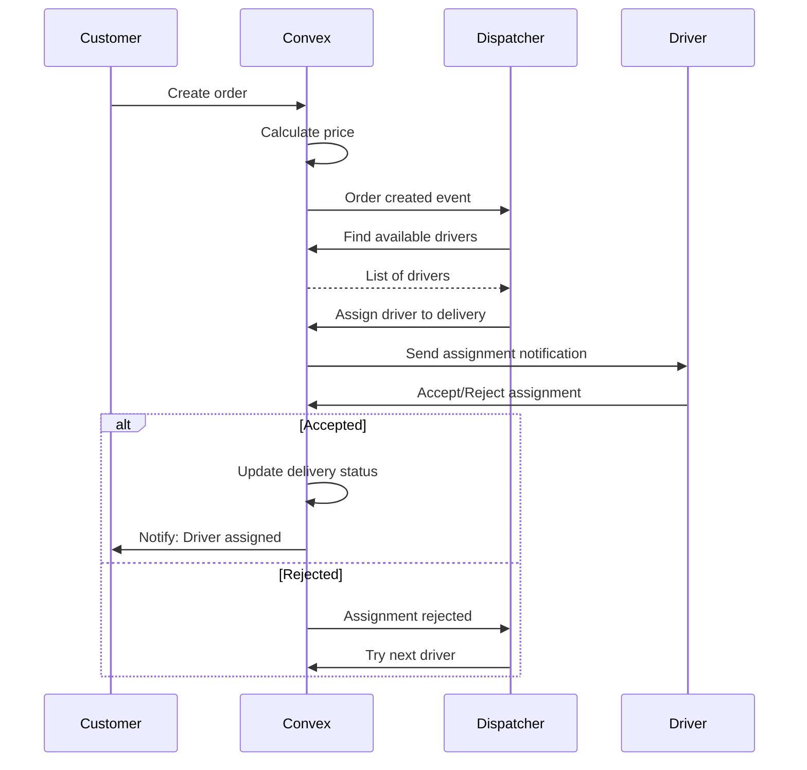

# Lasha Architecture — Vite + React + Convex

> **Canonical architecture document** — Defines how the Lasha logistics platform is structured around Vite, React, and Convex. All implementation phases reference this document.

---

## System Architecture Diagram



---

## 1. System Architecture

### 1.1 Technology Stack

| Layer | Technology | Version | Purpose |
|-------|-----------|---------|---------|
| Build | Vite | 7.2.6 | Dev server, HMR, production builds |
| UI | React | 19.2.0 | Component rendering, state management |
| Language | TypeScript | 5.9.3 | Type safety across entire stack |
| Routing | React Router | 7.10.0 | Client-side navigation |
| Styling | Tailwind CSS | 4.1.17 | Utility-first styling |
| Components | shadcn/ui + Radix | — | Accessible, composable UI primitives |
| Animation | Framer Motion | 12.23.25 | Page transitions, micro-interactions |
| Icons | Lucide React | 0.555.0 | Icon library |
| Forms | React Hook Form + Zod | 7.67.0 / 4.1.13 | Form state, validation |
| Charts | Recharts | 2.15.4 | Data visualization |
| Backend | Convex | 1.30.0 | Database, serverless functions, real-time |
| Auth | @convex-dev/auth | 0.0.90 | Email OTP + Anonymous auth |

### 1.2 Architecture Principles

1. **Convex is the single source of truth.** All business data, rules, and state live in Convex. React components are thin renderers.

2. **Domain-oriented module boundaries.** Convex functions are organized by business domain, not by UI screens.

3. **Reactive by default.** Use Convex subscriptions (`useQuery`) for real-time data. Never poll, manually refetch, or duplicate server state in React.

4. **No business logic in React.** React handles rendering, user interaction, form state, and local UI state. All validation, authorization, state transitions, and business rules live in Convex.

5. **Actions for external services.** Any external API call (email, SMS, payments, mapping) happens exclusively in Convex actions. Never call external APIs from React.

6. **Internal functions for cross-domain access.** Domain modules expose `internalQuery`/`internalMutation` for other domains. Public functions are for React only.

### 1.3 The Only Permitted Architecture

```
React/Vite (Client)
    ↓
Convex (Backend — database, functions, auth, storage, real-time)
    ↓
External services (where required — payments, mapping, SMS, email)
```

No PostgreSQL. No Firebase. No Supabase. No Express. No NestJS. No separate REST backend. Convex handles everything.

---

## 2. React Architecture

### 2.1 Application Structure

```
src/
├── main.tsx                         # App bootstrap, providers, routes
├── index.css                        # Global styles, Tailwind, CSS variables
│
├── components/
│   ├── RequireAuth.tsx              # Auth guard with dev bypass
│   ├── LogoDropdown.tsx             # Brand dropdown
│   │
│   ├── dashboard/                   # Dashboard-specific components
│   │   ├── TopNavigation.tsx        # Top navigation bar
│   │   ├── Sidebar.tsx              # Left sidebar navigation
│   │   ├── OrderPanel.tsx           # Order list container
│   │   ├── OrderCard.tsx            # Individual order card
│   │   ├── OrderFilters.tsx         # Status filter tabs
│   │   ├── SearchBar.tsx            # Search input
│   │   ├── DetailsPanel.tsx         # Order details container
│   │   ├── DetailTabs.tsx           # Tab navigation
│   │   ├── OrderDetailsTab.tsx      # Order info tab
│   │   ├── VehiclePanel.tsx         # Vehicle details tab
│   │   ├── DriverDetailsTab.tsx     # Driver info tab
│   │   ├── CustomerDetailsTab.tsx   # Customer info tab
│   │   └── SpecificationCard.tsx    # Reusable spec display
│   │
│   ├── lasha/                       # Landing page components
│   │   ├── Navbar.tsx
│   │   ├── Hero.tsx
│   │   ├── WhyLasha.tsx
│   │   ├── WhoWeServe.tsx
│   │   ├── HowItWorks.tsx
│   │   ├── About.tsx
│   │   ├── SectorIntelligence.tsx
│   │   ├── FAQ.tsx
│   │   ├── FinalCTA.tsx
│   │   └── Footer.tsx
│   │
│   └── ui/                          # shadcn/ui primitives (50+ components)
│
├── pages/                           # Route-level page components
│   ├── Landing.tsx                  # Public landing page
│   ├── Auth.tsx                     # Email OTP sign-in
│   ├── Dashboard.tsx                # Activity Center (order management)
│   ├── RequestDelivery.tsx          # Create delivery request
│   ├── TrackDelivery.tsx            # Track shipment by ID
│   ├── Wallet.tsx                   # Wallet balance, transactions
│   ├── Settings.tsx                 # Profile, business, notifications, security
│   ├── PastDeliveries.tsx           # Order history
│   ├── Invoices.tsx                 # Invoice management
│   ├── MakePayment.tsx              # Payment processing
│   ├── Notifications.tsx            # Notification center
│   ├── Help.tsx                     # Help center (static)
│   ├── Legal.tsx                    # Legal documents (static)
│   ├── Downloads.tsx                # Document downloads (static)
│   └── NotFound.tsx                 # 404 page
│
├── hooks/
│   ├── use-auth.ts                  # Auth hook (Convex auth + user query)
│   ├── use-mobile.ts                # Responsive detection
│   └── useDashboardNav.ts           # Sidebar navigation + sign-out
│
├── data/
│   └── orders.ts                    # MOCK DATA (to be replaced by Convex)
│
├── styles/
│   ├── dashboard.css
│   ├── pages.css
│   ├── request-delivery.css
│   ├── settings.css
│   ├── track-delivery.css
│   └── wallet.css
│
├── lib/
│   └── utils.ts                     # cn() utility
│
├── types/
│   └── global.d.ts                  # Global type declarations
│
└── convex/                          # Backend (see Section 3)
```

### 2.2 Route Architecture

```
/                    → Landing        (public)
/auth                → Auth           (public, redirect if authenticated)
/dashboard           → Dashboard      (protected — Activity Center)
/request-delivery    → RequestDelivery (protected — create order)
/track-delivery      → TrackDelivery  (protected — track shipment)
/wallet              → Wallet         (protected — wallet & transactions)
/settings            → Settings       (protected — account settings)
/past-deliveries     → PastDeliveries (protected — order history)
/invoices            → Invoices       (protected — invoice management)
/make-payment        → MakePayment    (protected — payment processing)
/notifications       → Notifications  (protected — notification center)
/help                → Help           (protected — help center)
/legal               → Legal          (protected — legal documents)
/downloads           → Downloads      (protected — document downloads)
*                    → NotFound       (public — 404 page)
```

### 2.3 Auth Guard Pattern

```tsx
// RequireAuth.tsx
// Guards all protected routes
// Supports dev bypass:
//   1. URL params: ?dev=true or ?guest=true
//   2. Session storage: sessionStorage("lasha_guest") === "true"
// On unauthenticated access: redirects to /auth?returnTo={currentPath}
```

### 2.4 Component Responsibilities

| Component | Responsibility | State Source |
|-----------|---------------|--------------|
| Dashboard | Layout orchestration, order selection | Local `useState` + Convex queries |
| OrderPanel | List filtering, search, selection | Local filter state + Convex query |
| DetailsPanel | Order detail display, tab switching | Local tab state + Convex query |
| Sidebar | Navigation, sign-out | Local active state + route |
| RequestDelivery | Form state, validation | Local form state (React Hook Form) |
| TrackDelivery | Tracking lookup, display | Local input + Convex query |
| Wallet | Balance, transactions, top-up | Convex queries + local modal state |
| Settings | Profile, business, notifications, security | Convex queries + local form state |

### 2.5 Data Flow Pattern

```
User Action → React Event Handler → Convex Mutation
                                         ↓
                                    Convex Database
                                         ↓
                                    Convex Query (subscription)
                                         ↓
                                    React Re-render (automatic)
```

---

## 3. Convex Architecture

### 3.1 Directory Structure

```
src/convex/
├── _generated/                      # Auto-generated types (DO NOT EDIT)
│   ├── api.d.ts
│   ├── server.d.ts
│   └── dataModel.d.ts
│
├── auth/                            # Authentication providers
│   └── emailOtp.ts                  # Email OTP provider (auth.freebuff.app)
├── auth.config.ts                   # Auth configuration (Convex + VLY)
├── auth.ts                          # Convex auth setup (READ ONLY)
├── http.ts                          # HTTP router (auth routes)
├── schema.ts                        # Database schema (source of truth)
├── users.ts                         # User queries (READ ONLY)
│
├── domains/                         # Domain modules
│   ├── users/
│   │   ├── queries.ts               # Public: getCurrentUser, getUserProfile
│   │   ├── mutations.ts             # Public: updateProfile, updateSettings
│   │   └── internal.ts              # Internal: getUserById (for other domains)
│   │
│   ├── companies/
│   │   ├── queries.ts               # Public: getCompany, getCompanyMembers
│   │   ├── mutations.ts             # Public: createCompany, updateCompany
│   │   └── internal.ts              # Internal: getCompanyByOwner
│   │
│   ├── addresses/
│   │   ├── queries.ts               # Public: getUserAddresses
│   │   ├── mutations.ts             # Public: addAddress, updateAddress, deleteAddress
│   │   └── internal.ts              # Internal: getAddressById
│   │
│   ├── orders/
│   │   ├── queries.ts               # Public: getOrder, getUserOrders, getBusinessOrders
│   │   ├── mutations.ts             # Public: createOrder, cancelOrder
│   │   ├── internal.ts              # Internal: getOrderForDispatch, updateOrderStatus
│   │   └── validators.ts            # Order status transition rules
│   │
│   ├── deliveries/
│   │   ├── queries.ts               # Public: getDelivery, getOrderDeliveries
│   │   ├── mutations.ts             # Public: None (dispatch handles assignment)
│   │   ├── internal.ts              # Internal: createDelivery, updateDeliveryStatus
│   │   └── validators.ts            # Delivery status transition rules
│   │
│   ├── drivers/
│   │   ├── queries.ts               # Public: getDriverProfile, getAvailableDrivers
│   │   ├── mutations.ts             # Public: updateAvailability, updateLocation
│   │   ├── internal.ts              # Internal: getDriverById, incrementDriverStats
│   │   └── validators.ts            # Driver availability rules
│   │
│   ├── vehicles/
│   │   ├── queries.ts               # Public: getVehicle, getDriverVehicles
│   │   ├── mutations.ts             # Public: addVehicle, updateVehicle
│   │   ├── internal.ts              # Internal: getVehicleById, checkVehicleCapacity
│   │   └── validators.ts            # Vehicle validation rules
│   │
│   ├── dispatch/
│   │   ├── queries.ts               # Public: getActiveDispatches
│   │   ├── mutations.ts             # Public: None
│   │   ├── actions.ts               # Actions: dispatchDelivery
│   │   └── internal.ts              # Internal: assignDriverToDelivery, cancelDispatch
│   │
│   ├── trips/
│   │   ├── queries.ts               # Public: getTrip, getTripHistory
│   │   ├── mutations.ts             # Public: None
│   │   ├── internal.ts              # Internal: startTrip, completeTrip, addTripEvent
│   │   └── validators.ts            # Trip status transition rules
│   │
│   ├── tracking/
│   │   ├── queries.ts               # Public: getDeliveryTracking, getLocationHistory
│   │   ├── mutations.ts             # Public: reportLocation (driver app)
│   │   ├── internal.ts              # Internal: saveLocationUpdate
│   │   └── validators.ts            # Location validation
│   │
│   ├── routing/
│   │   ├── queries.ts               # Public: getRoute
│   │   ├── actions.ts               # Actions: calculateRoute, getDistanceMatrix
│   │   └── internal.ts              # Internal: computeRouteForPricing
│   │
│   ├── pricing/
│   │   ├── queries.ts               # Public: getDeliveryQuote
│   │   ├── mutations.ts             # Public: None
│   │   ├── actions.ts               # Actions: calculatePrice
│   │   └── internal.ts              # Internal: applyPricingRules
│   │
│   ├── proofOfDelivery/
│   │   ├── queries.ts               # Public: getProofOfDelivery
│   │   ├── mutations.ts             # Public: submitProofOfDelivery
│   │   ├── actions.ts               # Actions: uploadDeliveryPhoto
│   │   └── internal.ts              # Internal: verifyProofOfDelivery
│   │
│   ├── notifications/
│   │   ├── queries.ts               # Public: getUserNotifications, getUnreadCount
│   │   ├── mutations.ts             # Public: markAsRead, markAllRead
│   │   ├── actions.ts               # Actions: sendPushNotification, sendSMS
│   │   └── internal.ts              # Internal: createNotification
│   │
│   ├── payments/
│   │   ├── queries.ts               # Public: getWalletBalance, getTransactions
│   │   ├── mutations.ts             # Public: topUpWallet, requestWithdrawal
│   │   ├── actions.ts               # Actions: processPayment, processRefund
│   │   └── internal.ts              # Internal: debitWallet, creditWallet, settleDriver
│   │
│   ├── invoices/
│   │   ├── queries.ts               # Public: getInvoices, getInvoice
│   │   ├── mutations.ts             # Public: generateInvoice
│   │   ├── internal.ts              # Internal: createInvoiceForOrder
│   │   └── validators.ts            # Invoice validation rules
│   │
│   ├── analytics/
│   │   ├── queries.ts               # Public: getDashboardStats, getDeliveryMetrics
│   │   └── internal.ts              # Internal: computeAnalytics
│   │
│   ├── audit/
│   │   ├── queries.ts               # Public: getAuditLogs (admin only)
│   │   └── internal.ts              # Internal: logAction
│   │
│   └── shared/
│       ├── utils.ts                 # Shared utilities (formatting, ID generation)
│       ├── constants.ts             # Shared constants (statuses, limits, timeouts)
│       └── validators.ts            # Shared validators (pagination, date ranges)
│
└── index.ts                         # Re-exports all public functions
```

### 3.2 Function Types and Rules

| Function Type | Convex Keyword | Access Level | Use Case |
|--------------|----------------|--------------|----------|
| Public Query | `query` | React can call | Data fetching for UI display |
| Public Mutation | `mutation` | React can call | Data modification from UI |
| Public Action | `action` | React can call | External API calls, complex orchestration |
| HTTP Action | `httpAction` | HTTP endpoints | Webhooks, third-party callbacks |
| Internal Query | `internalQuery` | Other functions only | Cross-domain data access |
| Internal Mutation | `internalMutation` | Other functions only | Cross-domain data modification |
| Internal Action | `internalAction` | Other functions only | Cross-domain external calls |

### 3.3 When to Use Each Function Type

```
QUERY — Read data, reactive subscription
├── UI needs to display data
├── Data should update in real-time
├── No side effects
├── Example: getUserOrders, getOrder, getWalletBalance
└── NEVER: modify state, call external APIs

MUTATION — Write data, atomic operation
├── User is modifying application state
├── Must be idempotent where possible
├── Should validate inputs with Zod
├── Should check authorization
├── Example: createOrder, cancelOrder, updateProfile
└── NEVER: call external APIs, perform slow operations

ACTION — Complex logic, external calls
├── Need to call external APIs (Paystack, Google Maps, SMS)
├── Need to orchestrate multiple mutations
├── Need to process data asynchronously
├── May have side effects (send email, SMS)
├── Example: processPayment, sendNotification, calculateRoute
└── NEVER: access database directly (use ctx.runQuery/runMutation)

INTERNAL QUERY/MUTATION — Cross-domain access
├── One domain needs data from another domain
├── Encapsulates domain logic
├── Not exposed to React
├── Example: getOrderForDispatch, assignDriverToDelivery
└── NEVER: expose to React via api.domains.*.internal.*
```

### 3.4 Naming Conventions

```typescript
// Queries — verb + noun, lowercase camelCase
export const getOrder = query({ ... });
export const getUserOrders = query({ ... });
export const getActiveDispatches = query({ ... });

// Mutations — verb + noun
export const createOrder = mutation({ ... });
export const updateOrderStatus = mutation({ ... });
export const cancelOrder = mutation({ ... });

// Actions — verb + noun (often with context)
export const processPayment = action({ ... });
export const sendDeliveryNotification = action({ ... });
export const calculateRoute = action({ ... });

// Internal — same pattern, used for cross-domain calls
export const getOrderByDeliveryId = internalQuery({ ... });
export const assignDriverToDelivery = internalMutation({ ... });
```

---

## 4. Domain Boundaries

### 4.1 Domain Dependency Graph

```
┌─────────────────────────────────────────────────────────┐
│                    SHARED DOMAIN                        │
│              (validators, utils, constants)             │
└─────────────────────────────────────────────────────────┘
                           ↑
┌──────────┬──────────┬──────────┬──────────┬──────────┐
│  USERS   │COMPANIES │ADDRESSES │ VEHICLES │ DRIVERS  │
└──────────┴──────────┴──────────┴──────────┴──────────┘
                           ↑
┌─────────────────────────────────────────────────────────┐
│                    ORDERS DOMAIN                       │
│          (depends on: users, companies, addresses)     │
└─────────────────────────────────────────────────────────┘
                           ↑
┌─────────────────────────────────────────────────────────┐
│                   DELIVERIES DOMAIN                    │
│          (depends on: orders, drivers, vehicles)       │
└─────────────────────────────────────────────────────────┘
                           ↑
┌─────────────┬─────────────┬─────────────┬─────────────┐
│   DISPATCH  │    TRIPS    │   TRACKING  │   PRICING   │
│(deliveries) │(deliveries) │ (deliveries) │  (orders)   │
└─────────────┴─────────────┴─────────────┴─────────────┘
                           ↑
┌─────────────┬─────────────┬─────────────┬─────────────┐
│    PROOF    │NOTIFICATIONS│   PAYMENTS  │   INVOICES  │
│ OF DELIVERY │  (orders,   │  (orders,   │  (orders,   │
│ (deliveries)│  users)     │  users)     │  companies) │
└─────────────┴─────────────┴─────────────┴─────────────┘
```

### 4.2 Allowed Dependencies

| Domain | Can Import From |
|--------|-----------------|
| `shared` | (none — leaf node) |
| `users` | `shared` |
| `companies` | `shared`, `users` |
| `addresses` | `shared`, `users` |
| `vehicles` | `shared` |
| `drivers` | `shared`, `users`, `vehicles` |
| `orders` | `shared`, `users`, `companies`, `addresses` |
| `deliveries` | `shared`, `orders`, `drivers`, `vehicles` |
| `dispatch` | `shared`, `deliveries`, `drivers`, `vehicles`, `orders` |
| `trips` | `shared`, `deliveries`, `drivers`, `vehicles` |
| `tracking` | `shared`, `deliveries`, `drivers` |
| `routing` | `shared` (external API only) |
| `pricing` | `shared`, `orders`, `deliveries` |
| `proofOfDelivery` | `shared`, `deliveries`, `orders` |
| `notifications` | `shared`, `orders`, `users`, `deliveries` |
| `payments` | `shared`, `orders`, `users`, `companies` |
| `invoices` | `shared`, `orders`, `companies` |
| `analytics` | `shared` (aggregates from multiple domains) |
| `audit` | `shared` |

### 4.3 Forbidden Patterns

1. **No circular dependencies.** Domain A cannot import from Domain B if Domain B imports from Domain A.

2. **No direct table access across domains.** Always use internal queries/mutations. Never write `ctx.db.query("orders")` from the `drivers` domain.

3. **No React in Convex.** Convex functions are server-side only. Never import React components or hooks.

4. **No external calls in queries/mutations.** All HTTP requests to external services must happen in actions.

5. **No business logic in React.** Form validation can exist in React for UX, but authoritative validation must also exist in Convex mutations.

6. **No exposing internal functions to React.** Internal functions are only for cross-domain use within Convex.

---

## 5. Data Ownership

### 5.1 Schema Tables and Domain Ownership

| Domain | Owns Tables | Description |
|--------|------------|-------------|
| `users` | `users` | User profiles, auth data, roles |
| `companies` | `businesses` | Business accounts, B2B info |
| `addresses` | `addresses` | Saved delivery locations |
| `orders` | `orders` | Customer shipment requests |
| `deliveries` | `deliveries` | Courier assignments, delivery tracking |
| `drivers` | `driver_profiles` | Driver-specific data, ratings, stats |
| `vehicles` | `vehicles` | Fleet vehicles, capacity, specs |
| `trips` | `trips`, `trip_events` | Trip lifecycle, events |
| `tracking` | `tracking_events` | Delivery location history |
| `pricing` | `pricing_rules`, `delivery_quotes` | Pricing logic, quotes |
| `proofOfDelivery` | `proof_of_delivery` | Photos, signatures, confirmation |
| `notifications` | `notifications`, `notification_preferences` | User alerts, settings |
| `payments` | `wallets`, `transactions`, `driver_earnings` | Financial operations |
| `invoices` | `invoices` | Billing documents |
| `reviews` | `reviews` | Post-delivery ratings |
| `audit` | `audit_logs` | System audit trail |

### 5.2 Cross-Domain Data Access

```typescript
// ✅ CORRECT: Use internal query from another domain
// In dispatch/queries.ts
const delivery = await ctx.runQuery(
  api.domains.deliveries.internal.getDeliveryById,
  { deliveryId }
);

// ❌ WRONG: Direct table access from a different domain
const delivery = await ctx.db.get(deliveryId); // Never do this across domains
```

---

## 6. Query/Mutation/Action Rules

### 6.1 Query Pattern

```typescript
// Simple read with authorization
export const getOrder = query({
  args: { orderId: v.id("orders") },
  handler: async (ctx, args) => {
    const userId = await getAuthUserId(ctx);
    if (!userId) throw new Error("Not authenticated");

    const order = await ctx.db.get(args.orderId);
    if (!order) throw new Error("Order not found");

    // Authorization: only sender or business member can view
    if (order.senderId !== userId) {
      const user = await ctx.db.get(userId);
      if (!user?.businessId || user.businessId !== order.businessId) {
        throw new Error("Unauthorized");
      }
    }

    return order;
  },
});

// List with filtering and pagination
export const getUserOrders = query({
  args: {
    status: v.optional(orderStatusValidator),
    limit: v.optional(v.number()),
  },
  handler: async (ctx, args) => {
    const userId = await getAuthUserId(ctx);
    if (!userId) throw new Error("Not authenticated");

    let q = ctx.db
      .query("orders")
      .withIndex("by_sender", (idx) => idx.eq("senderId", userId));

    if (args.status) {
      q = q.filter((f) => f.eq(f.field("status"), args.status));
    }

    return await q.order("desc").take(args.limit ?? 50);
  },
});
```

### 6.2 Mutation Pattern

```typescript
// Create with validation and authorization
export const createOrder = mutation({
  args: {
    pickupAddressId: v.id("addresses"),
    dropoffAddressId: v.id("addresses"),
    description: v.string(),
    packageSize: v.union(v.literal("small"), v.literal("medium"), v.literal("large")),
    scheduledTime: v.optional(v.number()),
  },
  handler: async (ctx, args) => {
    const userId = await getAuthUserId(ctx);
    if (!userId) throw new Error("Not authenticated");

    // Validate addresses belong to user
    const pickup = await ctx.db.get(args.pickupAddressId);
    const dropoff = await ctx.db.get(args.dropoffAddressId);
    if (!pickup || !dropoff) throw new Error("Invalid address");
    if (pickup.userId !== userId || dropoff.userId !== userId) {
      throw new Error("Unauthorized");
    }

    // Calculate price (internal call)
    const price = await ctx.runQuery(
      api.domains.pricing.internal.calculatePrice,
      { pickup, dropoff, packageSize: args.packageSize }
    );

    // Create order
    const orderId = await ctx.db.insert("orders", {
      senderId: userId,
      pickupAddressId: args.pickupAddressId,
      dropoffAddressId: args.dropoffAddressId,
      status: "pending",
      description: args.description,
      packageSize: args.packageSize,
      price,
      scheduledTime: args.scheduledTime,
      createdAt: Date.now(),
      updatedAt: Date.now(),
    });

    // Create audit log
    await ctx.runMutation(
      api.domains.audit.internal.logAction,
      { action: "order_created", entityId: orderId, userId }
    );

    return orderId;
  },
});

// Status transition with validation
export const cancelOrder = mutation({
  args: { orderId: v.id("orders") },
  handler: async (ctx, args) => {
    const userId = await getAuthUserId(ctx);
    const order = await ctx.db.get(args.orderId);

    if (!order) throw new Error("Order not found");
    if (order.senderId !== userId) throw new Error("Unauthorized");
    if (order.status !== "pending") {
      throw new Error("Cannot cancel order in current status");
    }

    await ctx.db.patch(args.orderId, {
      status: "cancelled",
      updatedAt: Date.now(),
    });

    await ctx.runMutation(
      api.domains.audit.internal.logAction,
      { action: "order_cancelled", entityId: args.orderId, userId }
    );

    return { success: true };
  },
});
```

### 6.3 Action Pattern

```typescript
// External API call
export const processPayment = action({
  args: {
    orderId: v.id("orders"),
    paymentMethod: v.string(),
  },
  handler: async (ctx, args) => {
    // Get order data via internal query
    const order = await ctx.runQuery(
      api.domains.orders.internal.getOrderById,
      { orderId: args.orderId }
    );

    // Call external payment gateway
    const response = await fetch("https://api.paystack.co/transaction/initialize", {
      method: "POST",
      headers: {
        Authorization: `Bearer ${process.env.PAYSTACK_SECRET_KEY}`,
        "Content-Type": "application/json",
      },
      body: JSON.stringify({
        email: order.customerEmail,
        amount: order.price * 100,
        reference: `LASHA-${order._id}`,
      }),
    });

    const data = await response.json();

    // Record transaction via internal mutation
    await ctx.runMutation(
      api.domains.payments.internal.recordTransaction,
      {
        orderId: args.orderId,
        amount: order.price,
        reference: data.data.reference,
        status: "pending",
      }
    );

    return { authorizationUrl: data.data.authorization_url };
  },
});

// Orchestrate multiple mutations
export const completeDelivery = action({
  args: { deliveryId: v.id("deliveries") },
  handler: async (ctx, args) => {
    // 1. Update delivery status
    await ctx.runMutation(
      api.domains.deliveries.internal.updateDeliveryStatus,
      { deliveryId: args.deliveryId, status: "delivered" }
    );

    // 2. Complete trip
    const trip = await ctx.runQuery(
      api.domains.trips.internal.getTripByDelivery,
      { deliveryId: args.deliveryId }
    );
    if (trip) {
      await ctx.runMutation(
        api.domains.trips.internal.completeTrip,
        { tripId: trip._id }
      );
    }

    // 3. Settle driver payment
    await ctx.runMutation(
      api.domains.payments.internal.settleDriverEarnings,
      { deliveryId: args.deliveryId }
    );

    // 4. Send notification
    const delivery = await ctx.runQuery(
      api.domains.deliveries.internal.getDeliveryById,
      { deliveryId: args.deliveryId }
    );
    await ctx.runMutation(
      api.domains.notifications.internal.createNotification,
      {
        userId: delivery.customerId,
        type: "delivery_completed",
        title: "Delivery Complete",
        message: "Your package has been delivered!",
        entityId: args.deliveryId,
      }
    );

    // 5. Audit log
    await ctx.runMutation(
      api.domains.audit.internal.logAction,
      { action: "delivery_completed", entityId: args.deliveryId }
    );

    return { success: true };
  },
});
```

---

## 7. Authentication Architecture

### 7.1 Auth Flow



### 7.2 Auth Providers

| Provider | Type | Purpose | Status |
|----------|------|---------|--------|
| Email OTP | Primary | 6-digit code via `auth.freebuff.app` | ✅ Implemented |
| Anonymous | Guest | Limited access for demo/preview | ✅ Implemented |
| VLY Convex JWT | Federated | Freebuff platform SSO | ✅ Implemented |

### 7.3 Auth Configuration

```typescript
// convex/auth.config.ts
{
  providers: [
    // Project's own auth (self-issued JWTs)
    { domain: CONVEX_SITE_URL, applicationID: "convex" },
    // Freebuff federated auth
    { type: "customJwt", issuer: "https://freebuff.com", ... }
  ]
}
```

### 7.4 Auth Guard Pattern

```typescript
// In every query/mutation that requires auth:
const userId = await getAuthUserId(ctx);
if (!userId) throw new Error("Not authenticated");

// In React:
const { isAuthenticated, user } = useAuth();
if (!isAuthenticated) return <Navigate to="/auth" />;
```

### 7.5 Dev Bypass

```typescript
// RequireAuth.tsx supports:
// 1. URL params: ?dev=true or ?guest=true
// 2. Session storage: sessionStorage("lasha_guest") === "true"
// Bypasses auth check for development/testing
```

---

## 8. Authorization Architecture

### 8.1 Role-Based Access Control

```typescript
// Schema defines roles:
ROLES = {
  ADMIN: "admin"       // Full system access
  USER: "user"         // Basic customer
  MEMBER: "member"     // Team member within a business
  BUSINESS: "business" // Business account owner
  COURIER: "courier"   // Driver/delivery person
}
```

### 8.2 Authorization Rules

| Action | User | Business | Member | Courier | Admin |
|--------|------|----------|--------|---------|-------|
| View own orders | ✅ | ✅ | ✅ | ❌ | ✅ |
| Create order | ✅ | ✅ | ✅ | ❌ | ✅ |
| Cancel own order | ✅ | ✅ | ✅ | ❌ | ✅ |
| View all orders | ❌ | ❌ | ❌ | ❌ | ✅ |
| Assign driver | ❌ | ❌ | ❌ | ❌ | ✅ |
| Update delivery status | ❌ | ❌ | ❌ | ✅ (own) | ✅ |
| View wallet | ✅ | ✅ | ✅ | ❌ | ✅ |
| Top up wallet | ✅ | ✅ | ✅ | ❌ | ✅ |
| View invoices | ❌ | ✅ | ✅ | ❌ | ✅ |
| Manage settings | ✅ | ✅ | ✅ | ✅ | ✅ |
| Manage drivers | ❌ | ❌ | ❌ | ❌ | ✅ |
| Manage vehicles | ❌ | ❌ | ❌ | ✅ (own) | ✅ |
| View audit logs | ❌ | ❌ | ❌ | ❌ | ✅ |

### 8.3 Authorization Utilities

```typescript
// Require authentication
async function requireAuth(ctx: QueryCtx | MutationCtx) {
  const userId = await getAuthUserId(ctx);
  if (!userId) throw new Error("Not authenticated");
  return userId;
}

// Require specific roles
async function requireRole(ctx: QueryCtx | MutationCtx, ...roles: Role[]) {
  const userId = await requireAuth(ctx);
  const user = await ctx.db.get(userId);
  if (!user || !roles.includes(user.role as Role)) {
    throw new Error("Unauthorized");
  }
  return userId;
}

// Usage
export const adminGetAllOrders = query({
  args: {},
  handler: async (ctx) => {
    await requireRole(ctx, "admin");
    return await ctx.db.query("orders").collect();
  },
});
```

---

## 9. Real-Time Architecture

### 9.1 Convex Reactive Queries

```typescript
// In React — automatic real-time updates
const orders = useQuery(api.domains.orders.queries.getUserOrders, {
  status: "in_transit",
});
// Automatically re-renders when orders change in database

// In React — single item subscription
const order = useQuery(api.domains.orders.queries.getOrder, {
  orderId: selectedOrderId,
});
// Automatically updates when this specific order changes
```

### 9.2 Real-Time Use Cases

| Feature | Real-Time Mechanism | Update Trigger |
|---------|--------------------| ---------------|
| Order status | Convex query subscription | Status mutation |
| Driver location | Convex query subscription | Location update (5-10s) |
| Delivery tracking | Convex query subscription | Trip event |
| Notifications | Convex query subscription | New notification |
| Wallet balance | Convex query subscription | Transaction |
| Active dispatches | Convex query subscription | Dispatch change |

### 9.3 Location Updates (Driver)

```typescript
// Driver reports location (called from driver app)
export const reportLocation = mutation({
  args: {
    lat: v.number(),
    lng: v.number(),
    deliveryId: v.optional(v.id("deliveries")),
  },
  handler: async (ctx, args) => {
    const userId = await requireRole(ctx, "courier");

    // Update driver's current location
    await ctx.db.patch(userId, {
      currentLat: args.lat,
      currentLng: args.lng,
      lastLocationUpdate: Date.now(),
    });

    // If on active delivery, record location event
    if (args.deliveryId) {
      const trip = await ctx.runQuery(
        api.domains.trips.internal.getTripByDelivery,
        { deliveryId: args.deliveryId }
      );
      if (trip) {
        await ctx.runMutation(
          api.domains.trips.internal.addTripEvent,
          {
            tripId: trip._id,
            type: "location_update",
            lat: args.lat,
            lng: args.lng,
          }
        );
      }
    }

    return { success: true };
  },
});
```

---

## 10. Dispatch Architecture

### 10.1 Dispatch Flow



### 10.2 Driver Assignment Logic

```typescript
export const assignDriverToDelivery = internalMutation({
  args: {
    deliveryId: v.id("deliveries"),
    driverId: v.id("users"),
  },
  handler: async (ctx, args) => {
    // 1. Check driver availability
    const driver = await ctx.runQuery(
      api.domains.drivers.internal.getDriverById,
      { driverId: args.driverId }
    );
    if (!driver.isAvailable) throw new Error("Driver not available");

    // 2. Check vehicle capacity
    const vehicle = await ctx.runQuery(
      api.domains.vehicles.internal.getVehicleById,
      { vehicleId: driver.vehicleId }
    );
    const order = await ctx.runQuery(
      api.domains.orders.internal.getOrderForDelivery,
      { deliveryId: args.deliveryId }
    );
    if (vehicle.capacity < order.weight) {
      throw new Error("Vehicle capacity insufficient");
    }

    // 3. Assign delivery
    await ctx.db.patch(args.deliveryId, {
      courierId: args.driverId,
      status: "confirmed",
    });

    // 4. Mark driver as unavailable
    await ctx.db.patch(args.driverId, { isAvailable: false });

    // 5. Create trip
    await ctx.runMutation(
      api.domains.trips.internal.createTrip,
      {
        deliveryId: args.deliveryId,
        driverId: args.driverId,
        vehicleId: driver.vehicleId,
      }
    );

    // 6. Audit log
    await ctx.runMutation(
      api.domains.audit.internal.logAction,
      {
        action: "driver_assigned",
        entityId: args.deliveryId,
        details: { driverId: args.driverId },
      }
    );

    return { success: true };
  },
});
```

---

## 11. Tracking Architecture

### 11.1 Tracking Data Model

```typescript
// Deliveries table — current state
{
  _id: "delivery_id",
  orderId: "order_id",
  courierId: "driver_id",
  status: "in_transit",
  pickupLat: -26.2041,
  pickupLng: 28.0473,
  dropoffLat: -26.1367,
  dropoffLng: 28.0433,
  estimatedArrival: 1690000000,
  startedAt: 1689990000,
}

// Tracking events table — granular updates
{
  _id: "event_id",
  deliveryId: "delivery_id",
  type: "location_update" | "status_change" | "arrival",
  lat: -26.19,
  lng: 28.04,
  timestamp: 1689995000,
  metadata: null,
}
```

### 11.2 Tracking Query

```typescript
export const getDeliveryTracking = query({
  args: { trackingId: v.string() },
  handler: async (ctx, args) => {
    // Look up delivery by tracking ID
    const delivery = await ctx.runQuery(
      api.domains.deliveries.internal.getDeliveryByTrackingId,
      { trackingId: args.trackingId }
    );
    if (!delivery) throw new Error("Delivery not found");

    // Get latest tracking events
    const events = await ctx.db
      .query("tracking_events")
      .withIndex("by_delivery", (q) => q.eq("deliveryId", delivery._id))
      .order("desc")
      .take(100);

    // Get driver info
    const driver = delivery.courierId
      ? await ctx.runQuery(
          api.domains.drivers.internal.getDriverById,
          { driverId: delivery.courierId }
        )
      : null;

    return { delivery, events, driver };
  },
});
```

---

## 12. External Service Architecture

### 12.1 External Services Map

| Service | Purpose | Integration Point |
|---------|---------|-------------------|
| Email OTP (`auth.freebuff.app`) | Send verification codes | Auth provider |
| Paystack | Payment processing | `payments/actions.ts` |
| Google Maps API | Geocoding, routing, distance | `routing/actions.ts`, `pricing/actions.ts` |
| SMS Gateway | Delivery notifications | `notifications/actions.ts` |
| Convex File Storage | POD photos, signatures | `proofOfDelivery/actions.ts` |

### 12.2 External Call Pattern

```typescript
// ✅ CORRECT: Through Convex actions, never from React
export const calculateRoute = action({
  args: {
    pickup: v.object({ lat: v.number(), lng: v.number() }),
    dropoff: v.object({ lat: v.number(), lng: v.number() }),
  },
  handler: async (ctx, args) => {
    const apiKey = process.env.GOOGLE_MAPS_API_KEY;
    const response = await fetch(
      `https://maps.googleapis.com/maps/api/directions/json?` +
      `origin=${args.pickup.lat},${args.pickup.lng}` +
      `&destination=${args.dropoff.lat},${args.dropoff.lng}` +
      `&key=${apiKey}`
    );
    const data = await response.json();
    return {
      distance: data.routes[0].legs[0].distance.value,
      duration: data.routes[0].legs[0].duration.value,
      polyline: data.routes[0].overview_polyline.points,
    };
  },
});

// ❌ WRONG: Direct API call from React
const response = await fetch("https://api.paystack.co/..."); // Never!
```

### 12.3 Environment Variables (Convex Actions Only)

```typescript
// Available in Convex functions via process.env:
process.env.PAYSTACK_SECRET_KEY
process.env.GOOGLE_MAPS_API_KEY
process.env.EMAIL_OTP_API_KEY
process.env.SMS_GATEWAY_KEY
process.env.VLY_APP_NAME
```

**Never log or expose secrets.** Never use secrets in queries or mutations (only in actions). Never include secrets in thrown error messages.

### 12.4 Authentication & Email Secret

**Authentication method: email + password** (Convex Auth `Password`
provider). See `docs/authentication.md` for the complete flows.

| | |
|---|---|
| Primary auth | `Password` provider (`src/convex/auth.ts`) — sign-up, sign-in, password reset. Passwords hashed with Scrypt by the provider; never stored or logged in plaintext. |
| Reset/email bridge | `src/convex/auth/email.ts` — sends password-reset codes only. |
| Variable | `EMAIL_API_KEY` (server-only Convex environment; never `VITE_`-prefixed). |
| Missing behaviour | Fails closed with a clear server-side configuration error naming the variable. No fallback key, no silent skip, no fake success. |
| Error hygiene | Provider/HTTP failures throw a generic "Failed to send email" — raw axios errors are never serialized (their `config.headers` contain the key). |
| Retired | `EMAIL_OTP_API_KEY` is no longer used by any code path — the email-OTP provider was removed. The previously exposed OTP bridge credential can be **retired/rotated** with the provider once legacy-account migration is complete. |

---

## 13. Error Handling Strategy

### 13.1 Convex Error Handling

```typescript
// Throw descriptive errors in Convex functions
throw new Error("Order not found");
throw new Error("Unauthorized");
throw new Error("Cannot cancel order in current status");
throw new Error("Invalid address");
throw new Error("Payment processing failed");
```

### 13.2 React Error Handling

```typescript
// Convex returns undefined while loading, null on error
const order = useQuery(api.orders.getOrder, { orderId });

// Handle loading with skeletons
if (order === undefined) return <Skeleton />;

// Handle error state
if (order === null) return <ErrorMessage />;

// For mutations:
const createOrder = useMutation(api.orders.createOrder);
try {
  await createOrder({ ... });
  toast.success("Order created!");
} catch (error) {
  toast.error(error.message);
}
```

### 13.3 Error Boundaries

```typescript
// main.tsx has RootErrorBoundary
// Catches any unhandled React errors
// Shows error message instead of blank page

// VlyToolbar has ToolbarErrorBoundary
// Isolates toolbar errors from main app
```

---

## 14. Offline Strategy

### 14.1 Current State

The application requires network connectivity. Convex handles:
- Automatic reconnection
- Optimistic updates (configurable)
- Offline queue for mutations (Convex SDK feature)

### 14.2 Offline Considerations

| Operation | Offline Behavior |
|-----------|-----------------|
| Reads (queries) | Returns cached data |
| Writes (mutations) | Queued, syncs when online |
| Real-time | Suspended, resumes on reconnect |
| Actions | Will fail if external APIs unreachable |

### 14.3 Future Enhancement

For full offline support:
1. Configure Convex offline mode
2. Cache critical data in IndexedDB
3. Queue critical mutations
4. Show connectivity status in UI

---

## 15. Testing Strategy

### 15.1 Unit Testing

| Target | Tool | Scope |
|--------|------|-------|
| Convex functions | Convex test utilities | Business logic, validation |
| React components | React Testing Library | Rendering, interaction |
| Form validation | Zod schemas | Input validation |
| Utilities | Vitest | Pure functions |

### 15.2 Integration Testing

| Flow | Test Case |
|------|-----------|
| Order creation | Create order → Calculate price → Store in DB |
| Auth flow | Login → Access protected route → Logout |
| Payment flow | Top up wallet → Process payment → Update balance |
| Driver assignment | Find available → Assign → Create trip |

### 15.3 E2E Testing

| Journey | Tool |
|---------|------|
| Landing → Auth → Dashboard → Create order | Playwright |
| Track delivery → View status → Contact driver | Playwright |

---

## 16. Deployment Architecture

### 16.1 Development

```
Local Machine
├── Vite Dev Server (port 5173)
├── Convex Dev Server (convex dev)
└── HMR enabled
```

### 16.2 Production

```
Freebuff Platform
├── Vite Build → Static Assets
├── Convex Cloud (serverless functions + database)
├── CDN (static assets)
└── Managed by Freebuff infrastructure
```

### 16.3 Environment Variables

| Variable | Location | Purpose |
|----------|----------|---------|
| `VITE_CONVEX_URL` | Client | Convex deployment URL |
| `CONVEX_SITE_URL` | Convex | Auth issuer URL |
| `PAYSTACK_SECRET_KEY` | Convex | Payment gateway |
| `GOOGLE_MAPS_API_KEY` | Convex | Mapping services |
| `VLY_APP_NAME` | Convex | App identifier |
| `VLY_INTEGRATION_KEY` | Client | VLY integrations |

---

## 17. Security Architecture

### 17.1 Security Layers

| Layer | Mechanism | Location |
|-------|-----------|----------|
| Auth | JWT validation, session management | Convex Auth |
| Function | `getAuthUserId()` check | Every query/mutation |
| Data | Users access only their own data | Handler logic |
| External | Secrets only in actions | Convex env |
| Input | Zod validators | Schema + function args |

### 17.2 Security Rules

1. **Never trust client input.** Validate everything in Convex.
2. **Least privilege.** Users access only what they need.
3. **No secrets in client.** All API keys in Convex env.
4. **Audit sensitive operations.** Log all state changes.
5. **Rate limiting.** Implement for public endpoints (future).

### 17.3 Data Protection

| Data Type | Protection |
|-----------|------------|
| Passwords | Not used (OTP auth) |
| PII | Encrypted at rest (Convex default) |
| Financial | PCI compliant via Paystack |
| Location | Accessible only to assigned parties |

---

## 18. Future Scaling Strategy

### 18.1 Phase 1: MVP (Current)

- Basic order management
- Simple driver assignment
- Wallet + payments
- Email notifications

### 18.2 Phase 2: Growth

- Real-time tracking with map
- Automated dispatch algorithm
- Multi-business support
- SMS notifications
- Invoice generation

### 18.3 Phase 3: Scale

- Advanced analytics dashboard
- Route optimization
- Fleet management
- API for third-party integrations
- Mobile app (React Native)

### 18.4 Convex Scaling Considerations

| Concern | Convex Solution |
|---------|-----------------|
| Database | Horizontal scaling (automatic) |
| Functions | Serverless, scales with demand |
| Real-time | WebSocket management (automatic) |
| File Storage | Managed uploads/downloads |
| Rate Limiting | Implement for public APIs |
| Caching | Query-level caching (automatic) |

### 18.5 Extraction Points (If Needed)

If scale requires microservices, these domains are designed to be extractable:

| Domain | Extraction Trigger |
|--------|-------------------|
| Dispatch | High-frequency driver matching |
| Pricing | Complex pricing engine |
| Analytics | Heavy aggregation workloads |
| Notifications | High-volume messaging |

Each domain exposes a clean interface that can be replaced without changing the rest of the system.

---

## Summary

Lasha is architected as a **Vite + React + Convex** application with:

1. **React** — Thin UI layer. Handles rendering, user interaction, and local form state.
2. **Convex** — Single source of truth. Owns all business logic, data, authorization, and real-time updates.
3. **Domain Modules** — 17 domain modules with clear boundaries and dependency rules.
4. **Internal Functions** — Controlled cross-domain access without exposing to React.
5. **Actions** — Isolated external service integrations (payments, mapping, SMS).
6. **Auth** — Email OTP + Anonymous with role-based access control (5 roles).

The architecture prioritizes:

- **Simplicity** over complexity
- **Convex primitives** over custom solutions
- **Real-time reactivity** over polling
- **Server-side logic** over client-side
- **Domain boundaries** over flat structure

This design scales from MVP to production while maintaining code quality and allowing future extraction of individual domains if scale demands it.
