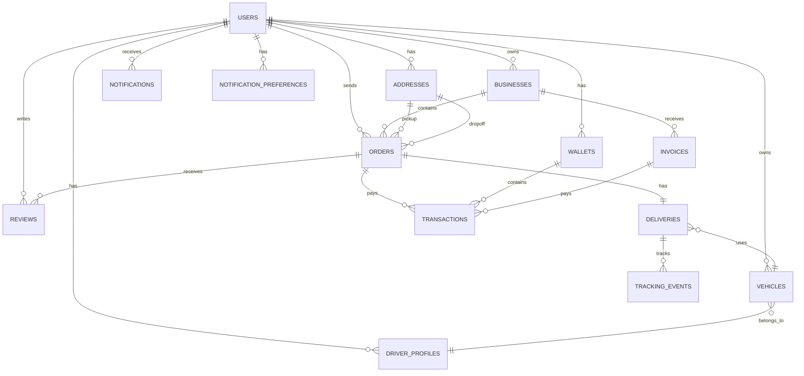

# Lasha Database Design

> **Canonical database specification** — Defines all Convex tables, relationships, indexes, and data strategies for the Lasha logistics platform.

---

## Table of Contents

1. [Design Principles](#1-design-principles)
2. [Entity Overview](#2-entity-overview)
3. [Entity Descriptions](#3-entity-descriptions)
4. [Relationships](#4-relationships)
5. [Index Strategy](#5-index-strategy)
6. [Data Retention Strategy](#6-data-retention-strategy)
7. [High-Frequency Data Strategy](#7-high-frequency-data-strategy)
8. [Security Considerations](#8-security-considerations)

---

## 1. Design Principles

1. **Business entities, not UI screens.** Tables represent domain concepts (orders, deliveries, vehicles), not React components.

2. **Normalized but practical.** Avoid over-normalization. Convex documents are self-contained; use references for relationships.

3. **Index every query pattern.** No full-table scans. Every query that filters or sorts must use an index.

4. **Separate current from historical.** Current operational state lives on the primary record. Historical data (status changes, location updates) lives in separate event tables.

5. **Timestamps everywhere.** All records have `createdAt`. Mutable records also have `updatedAt`.

6. **Soft delete where appropriate.** Records that might be referenced later are never hard-deleted.

---

## 2. Entity Overview

### 2.1 Existing Tables (Keep)

| Table | Purpose | Records |
|-------|---------|---------|
| `users` | User profiles, auth data, roles | One per user |
| `businesses` | B2B accounts | One per business |
| `addresses` | Saved delivery locations | Many per user |
| `orders` | Customer shipment requests | Many per user |
| `deliveries` | Courier assignments, tracking | One per order |
| `reviews` | Post-delivery ratings | Many per order |

### 2.2 New Tables (Add)

| Table | Purpose | Records |
|-------|---------|---------|
| `vehicles` | Fleet vehicle management | Many per driver |
| `driver_profiles` | Driver-specific data | One per driver |
| `wallets` | User wallet balances | One per user |
| `transactions` | Financial transaction history | Many per wallet |
| `invoices` | Invoice management | Many per business |
| `notifications` | User notifications | Many per user |
| `notification_preferences` | Notification settings | One per user |
| `tracking_events` | Delivery location history | Many per delivery |
| `pricing_rules` | Delivery pricing logic | Many active rules |

### 2.3 Tables Not Needed (MVP)

| Table | Reason Excluded |
|-------|-----------------|
| `driver_locations` | Current location stored on `users` record. History via `tracking_events`. |
| `dispatch_jobs` | Simple assignment via `deliveries` table. No complex dispatch queue. |
| `trips` / `trip_events` | Not needed for MVP. Can add later for detailed trip logging. |
| `proof_of_delivery` | Not needed for MVP. Can add later for delivery confirmation. |
| `audit_logs` | Not needed for MVP. Can add later for compliance. |
| `documents` | Static content served via frontend. No DB needed. |
| `support_tickets` | Static content served via frontend. No DB needed. |

---

## 3. Entity Descriptions

### 3.1 users

> Extends Convex Auth's user table with Lasha-specific fields.

```typescript
users: defineTable({
  // Auth fields (from @convex-dev/auth — do not remove)
  name: v.optional(v.string()),
  image: v.optional(v.string()),
  email: v.optional(v.string()),
  emailVerificationTime: v.optional(v.number()),
  isAnonymous: v.optional(v.boolean()),

  // Lasha fields
  role: v.optional(roleValidator),           // "admin" | "user" | "member" | "business" | "courier"
  phone: v.optional(v.string()),
  businessId: v.optional(v.id("businesses")),

  // Driver fields (only for couriers)
  currentLat: v.optional(v.number()),        // Last known latitude
  currentLng: v.optional(v.number()),        // Last known longitude
  lastLocationUpdate: v.optional(v.number()), // When location was last updated
}).index("email", ["email"])
 .index("by_business", ["businessId"])
 .index("by_role", ["role"])
```

**Query Patterns:**
- Get current user: `by_email` (already exists)
- Get business members: `by_business`
- Get available drivers: `by_role` where role = "courier"

---

### 3.2 businesses

> B2B accounts. Owned by a user.

```typescript
businesses: defineTable({
  name: v.string(),
  ownerUserId: v.id("users"),
  industry: v.optional(v.string()),
  phone: v.optional(v.string()),
  address: v.optional(v.string()),
  registrationNumber: v.optional(v.string()), // SA company registration
  createdAt: v.number(),
}).index("by_owner", ["ownerUserId"])
```

**Query Patterns:**
- Get business by owner: `by_owner`
- Get business by ID: default `_id` index

---

### 3.3 addresses

> Saved delivery locations for users and businesses.

```typescript
addresses: defineTable({
  userId: v.id("users"),
  label: v.string(),              // "Home", "Office", "Warehouse"
  street: v.string(),
  city: v.string(),
  state: v.optional(v.string()),
  zip: v.string(),
  lat: v.optional(v.number()),    // Geocoded latitude
  lng: v.optional(v.number()),    // Geocoded longitude
  isDefault: v.optional(v.boolean()),
}).index("by_user", ["userId"])
```

**Query Patterns:**
- Get user's addresses: `by_user`
- Get default address: filter by `isDefault`

---

### 3.4 orders

> Customer shipment requests. The primary business entity.

```typescript
orders: defineTable({
  senderId: v.id("users"),
  businessId: v.optional(v.id("businesses")),
  pickupAddressId: v.id("addresses"),
  dropoffAddressId: v.id("addresses"),
  status: orderStatusValidator,   // "pending" | "confirmed" | "picking_up" | "in_transit" | "delivered" | "cancelled"
  description: v.optional(v.string()),
  packageSize: v.union(v.literal("small"), v.literal("medium"), v.literal("large")),
  parcelType: v.optional(v.union(      // NEW: More specific parcel type
    v.literal("document"),
    v.literal("small_parcel"),
    v.literal("large_parcel"),
    v.literal("pallet"),
  )),
  expeditionType: v.optional(v.union(  // NEW: Delivery speed
    v.literal("standard"),
    v.literal("express"),
    v.literal("same_day"),
  )),
  width: v.optional(v.number()),       // NEW: Package width in cm
  height: v.optional(v.number()),      // NEW: Package height in cm
  weight: v.optional(v.number()),      // NEW: Package weight in kg
  price: v.number(),                   // Price in cents (ZAR)
  scheduledTime: v.optional(v.number()),
  trackingNumber: v.optional(v.string()), // Unique tracking ID
  createdAt: v.number(),
  updatedAt: v.number(),
}).index("by_sender", ["senderId"])
 .index("by_status", ["status"])
 .index("by_business", ["businessId"])
 .index("by_tracking", ["trackingNumber"])
 .index("by_sender_status", ["senderId", "status"])
 .index("by_created", ["createdAt"])
```

**Query Patterns:**
- Get user's orders: `by_sender`
- Get user's orders by status: `by_sender_status`
- Get business orders: `by_business`
- Get order by tracking number: `by_tracking`
- Get all orders (admin): `by_status`
- Get recent orders: `by_created`

**Status Flow:**
```
pending → confirmed → picking_up → in_transit → delivered
   ↓           ↓          ↓            ↓
cancelled   cancelled  cancelled    cancelled
```

---

### 3.5 deliveries

> Courier assignments. One delivery per order. Tracks the physical delivery process.

```typescript
deliveries: defineTable({
  orderId: v.id("orders"),
  courierId: v.optional(v.id("users")),
  vehicleId: v.optional(v.id("vehicles")),
  status: orderStatusValidator,
  trackingNumber: v.string(),             // Human-readable tracking ID
  pickupLat: v.optional(v.number()),
  pickupLng: v.optional(v.number()),
  dropoffLat: v.optional(v.number()),
  dropoffLng: v.optional(v.number()),
  estimatedArrival: v.optional(v.number()),
  actualArrival: v.optional(v.number()),
  startedAt: v.optional(v.number()),
  completedAt: v.optional(v.number()),
  assignedAt: v.optional(v.number()),     // When driver was assigned
  acceptedAt: v.optional(v.number()),     // When driver accepted
  rejectedAt: v.optional(v.number()),     // When driver rejected
  rejectionReason: v.optional(v.string()),
}).index("by_order", ["orderId"])
 .index("by_courier", ["courierId"])
 .index("by_status", ["status"])
 .index("by_tracking", ["trackingNumber"])
 .index("by_courier_status", ["courierId", "status"])
```

**Query Patterns:**
- Get delivery by order: `by_order`
- Get driver's active deliveries: `by_courier_status`
- Get all active deliveries (admin): `by_status`
- Get delivery by tracking number: `by_tracking`
- Get pending assignments: `by_status` where status = "pending"

---

### 3.6 reviews

> Post-delivery ratings. One review per order per reviewer.

```typescript
reviews: defineTable({
  orderId: v.id("orders"),
  reviewerId: v.id("users"),
  courierId: v.id("users"),
  rating: v.number(),          // 1-5
  comment: v.optional(v.string()),
  createdAt: v.number(),
}).index("by_order", ["orderId"])
 .index("by_courier", ["courierId"])
```

**Query Patterns:**
- Get reviews for an order: `by_order`
- Get reviews for a driver: `by_courier`

---

### 3.7 vehicles

> Fleet vehicles. Each vehicle belongs to a driver.

```typescript
vehicles: defineTable({
  driverId: v.id("users"),
  registration: v.string(),           // "FR35C0 GP"
  make: v.string(),                   // "Toyota"
  model: v.string(),                  // "Quantum"
  year: v.optional(v.number()),
  capacity: v.number(),               // kg
  breaking: v.boolean(),              // has breaking system
  express: v.boolean(),               // can do express deliveries
  flammable: v.boolean(),             // can carry flammable goods
  trailer: v.boolean(),               // has trailer
  isActive: v.boolean(),
  createdAt: v.number(),
}).index("by_driver", ["driverId"])
 .index("by_registration", ["registration"])
 .index("by_active_driver", ["driverId", "isActive"])
```

**Query Patterns:**
- Get driver's vehicles: `by_driver`
- Get active vehicles for a driver: `by_active_driver`
- Get vehicle by registration: `by_registration`

---

### 3.8 driver_profiles

> Driver-specific data. One profile per driver user.

```typescript
driver_profiles: defineTable({
  userId: v.id("users"),
  licenseClass: v.string(),           // "B Code 08", "C Code 10"
  licenseNumber: v.optional(v.string()),
  rating: v.number(),                 // 0-5 average
  totalTrips: v.number(),
  totalEarnings: v.number(),          // in cents
  isAvailable: v.boolean(),
  currentVehicleId: v.optional(v.id("vehicles")),
  createdAt: v.number(),
}).index("by_user", ["userId"])
 .index("by_available", ["isAvailable"])
```

**Query Patterns:**
- Get driver profile: `by_user`
- Get available drivers: `by_available` where isAvailable = true

---

### 3.9 wallets

> User wallet balances. One wallet per user.

```typescript
wallets: defineTable({
  userId: v.id("users"),
  balance: v.number(),                // in cents (ZAR)
  currency: v.literal("ZAR"),
  isActive: v.boolean(),
  createdAt: v.number(),
  updatedAt: v.number(),
}).index("by_user", ["userId"])
```

**Query Patterns:**
- Get user's wallet: `by_user`

---

### 3.10 transactions

> Financial transaction history. Every wallet mutation creates a transaction.

```typescript
transactions: defineTable({
  walletId: v.id("wallets"),
  type: v.union(v.literal("credit"), v.literal("debit")),
  amount: v.number(),                 // in cents
  description: v.string(),
  reference: v.optional(v.string()),  // "TOP-20260901-001"
  status: v.union(
    v.literal("completed"),
    v.literal("pending"),
    v.literal("failed"),
  ),
  orderId: v.optional(v.id("orders")),
  invoiceId: v.optional(v.id("invoices")),
  createdAt: v.number(),
}).index("by_wallet", ["walletId"])
 .index("by_wallet_status", ["walletId", "status"])
 .index("by_order", ["orderId"])
 .index("by_created", ["createdAt"])
```

**Query Patterns:**
- Get wallet transactions: `by_wallet`
- Get wallet transactions by status: `by_wallet_status`
- Get transactions for an order: `by_order`
- Get recent transactions: `by_created`

---

### 3.11 invoices

> Invoice management. Generated for businesses.

```typescript
invoices: defineTable({
  businessId: v.optional(v.id("businesses")),
  userId: v.id("users"),
  invoiceNumber: v.string(),          // "INV-2024-001"
  amount: v.number(),                 // in cents
  status: v.union(
    v.literal("paid"),
    v.literal("pending"),
    v.literal("cancelled"),
  ),
  dueDate: v.optional(v.number()),
  paidAt: v.optional(v.number()),
  createdAt: v.number(),
}).index("by_business", ["businessId"])
 .index("by_user", ["userId"])
 .index("by_status", ["status"])
 .index("by_number", ["invoiceNumber"])
```

**Query Patterns:**
- Get business invoices: `by_business`
- Get user invoices: `by_user`
- Get invoices by status: `by_status`
- Get invoice by number: `by_number`

---

### 3.12 notifications

> User notifications. Created by system events.

```typescript
notifications: defineTable({
  userId: v.id("users"),
  type: v.union(
    v.literal("delivery"),
    v.literal("payment"),
    v.literal("alert"),
  ),
  title: v.string(),
  description: v.string(),
  isRead: v.boolean(),
  entityId: v.optional(v.string()),  // related order/invoice ID
  createdAt: v.number(),
}).index("by_user", ["userId"])
 .index("by_user_unread", ["userId", "isRead"])
```

**Query Patterns:**
- Get user notifications: `by_user`
- Get unread notifications: `by_user_unread` where isRead = false

---

### 3.13 notification_preferences

> User notification settings. One record per user.

```typescript
notification_preferences: defineTable({
  userId: v.id("users"),
  emailNotifications: v.boolean(),
  smsNotifications: v.boolean(),
  pushNotifications: v.boolean(),
  deliveryUpdates: v.boolean(),
  marketingEmails: v.boolean(),
}).index("by_user", ["userId"])
```

**Query Patterns:**
- Get user preferences: `by_user`

---

### 3.14 tracking_events

> Delivery location history. High-frequency writes during active delivery.

```typescript
tracking_events: defineTable({
  deliveryId: v.id("deliveries"),
  type: v.union(
    v.literal("order_placed"),
    v.literal("picked_up"),
    v.literal("in_transit"),
    v.literal("delivered"),
    v.literal("location_update"),
  ),
  lat: v.optional(v.number()),
  lng: v.optional(v.number()),
  timestamp: v.number(),
  metadata: v.optional(v.string()),  // JSON string for extra data
}).index("by_delivery", ["deliveryId"])
 .index("by_delivery_time", ["deliveryId", "timestamp"])
```

**Query Patterns:**
- Get delivery events: `by_delivery`
- Get recent delivery events: `by_delivery_time` order desc

**Data Strategy:**
- Status change events: Always recorded (1 per status change)
- Location updates: Recorded every 30-60 seconds during active delivery
- Old events: Can be pruned after 90 days

---

### 3.15 pricing_rules

> Delivery pricing logic. Configurable rules.

```typescript
pricing_rules: defineTable({
  name: v.string(),
  packageSize: v.union(v.literal("small"), v.literal("medium"), v.literal("large")),
  parcelType: v.optional(v.union(
    v.literal("document"),
    v.literal("small_parcel"),
    v.literal("large_parcel"),
    v.literal("pallet"),
  )),
  expeditionType: v.union(v.literal("standard"), v.literal("express"), v.literal("same_day")),
  basePrice: v.number(),              // in cents
  pricePerKm: v.number(),             // in cents
  pricePerKg: v.number(),             // in cents
  minimumPrice: v.number(),           // in cents
  isActive: v.boolean(),
  createdAt: v.number(),
}).index("size_expedition", ["packageSize", "expeditionType", "isActive"])
```

**Query Patterns:**
- Get active pricing rule: `size_expedition` with filters

---

## 4. Relationships

### 4.1 Entity Relationship Diagram



### 4.2 Foreign Key Summary

| Table | Column | References | Required |
|-------|--------|------------|----------|
| `users` | `businessId` | `businesses._id` | Optional |
| `businesses` | `ownerUserId` | `users._id` | Required |
| `addresses` | `userId` | `users._id` | Required |
| `orders` | `senderId` | `users._id` | Required |
| `orders` | `businessId` | `businesses._id` | Optional |
| `orders` | `pickupAddressId` | `addresses._id` | Required |
| `orders` | `dropoffAddressId` | `addresses._id` | Required |
| `deliveries` | `orderId` | `orders._id` | Required |
| `deliveries` | `courierId` | `users._id` | Optional |
| `deliveries` | `vehicleId` | `vehicles._id` | Optional |
| `reviews` | `orderId` | `orders._id` | Required |
| `reviews` | `reviewerId` | `users._id` | Required |
| `reviews` | `courierId` | `users._id` | Required |
| `vehicles` | `driverId` | `users._id` | Required |
| `driver_profiles` | `userId` | `users._id` | Required |
| `wallets` | `userId` | `users._id` | Required |
| `transactions` | `walletId` | `wallets._id` | Required |
| `transactions` | `orderId` | `orders._id` | Optional |
| `transactions` | `invoiceId` | `invoices._id` | Optional |
| `invoices` | `businessId` | `businesses._id` | Optional |
| `invoices` | `userId` | `users._id` | Required |
| `notifications` | `userId` | `users._id` | Required |
| `notification_preferences` | `userId` | `users._id` | Required |
| `tracking_events` | `deliveryId` | `deliveries._id` | Required |

---

## 5. Index Strategy

### 5.1 Index Summary

| Table | Index | Columns | Purpose |
|-------|-------|---------|---------|
| `users` | `email` | `email` | Auth lookup |
| `users` | `by_business` | `businessId` | Business members |
| `users` | `by_role` | `role` | Role-based queries |
| `businesses` | `by_owner` | `ownerUserId` | Owner lookup |
| `addresses` | `by_user` | `userId` | User's addresses |
| `orders` | `by_sender` | `senderId` | User's orders |
| `orders` | `by_status` | `status` | Status filtering |
| `orders` | `by_business` | `businessId` | Business orders |
| `orders` | `by_tracking` | `trackingNumber` | Tracking lookup |
| `orders` | `by_sender_status` | `senderId`, `status` | User's orders by status |
| `orders` | `by_created` | `createdAt` | Recent orders |
| `deliveries` | `by_order` | `orderId` | Order's delivery |
| `deliveries` | `by_courier` | `courierId` | Driver's deliveries |
| `deliveries` | `by_status` | `status` | Active deliveries |
| `deliveries` | `by_tracking` | `trackingNumber` | Tracking lookup |
| `deliveries` | `by_courier_status` | `courierId`, `status` | Driver's active deliveries |
| `reviews` | `by_order` | `orderId` | Order reviews |
| `reviews` | `by_courier` | `courierId` | Driver reviews |
| `vehicles` | `by_driver` | `driverId` | Driver's vehicles |
| `vehicles` | `by_registration` | `registration` | Registration lookup |
| `vehicles` | `by_active_driver` | `driverId`, `isActive` | Active vehicles |
| `driver_profiles` | `by_user` | `userId` | Profile lookup |
| `driver_profiles` | `by_available` | `isAvailable` | Available drivers |
| `wallets` | `by_user` | `userId` | Wallet lookup |
| `transactions` | `by_wallet` | `walletId` | Wallet transactions |
| `transactions` | `by_wallet_status` | `walletId`, `status` | Filtered transactions |
| `transactions` | `by_order` | `orderId` | Order transactions |
| `transactions` | `by_created` | `createdAt` | Recent transactions |
| `invoices` | `by_business` | `businessId` | Business invoices |
| `invoices` | `by_user` | `userId` | User invoices |
| `invoices` | `by_status` | `status` | Status filtering |
| `invoices` | `by_number` | `invoiceNumber` | Invoice lookup |
| `notifications` | `by_user` | `userId` | User notifications |
| `notifications` | `by_user_unread` | `userId`, `isRead` | Unread count |
| `notification_preferences` | `by_user` | `userId` | Preferences lookup |
| `tracking_events` | `by_delivery` | `deliveryId` | Delivery events |
| `tracking_events` | `by_delivery_time` | `deliveryId`, `timestamp` | Recent events |
| `pricing_rules` | `size_expedition` | `packageSize`, `expeditionType`, `isActive` | Active rules |

### 5.2 Index Design Rules

1. **Compound indexes** for multi-column filters (e.g., `by_sender_status`).
2. **Cover common queries** — every `useQuery` in React must use an index.
3. **Order matters** — most selective column first.
4. **Avoid over-indexing** — each index costs write performance.

---

## 6. Data Retention Strategy

### 6.1 Retention Policies

| Table | Retention | Action |
|-------|-----------|--------|
| `users` | Indefinite | Soft delete (set `isActive: false`) |
| `businesses` | Indefinite | Soft delete |
| `addresses` | Indefinite | Hard delete (user action) |
| `orders` | Indefinite | Never delete (audit trail) |
| `deliveries` | Indefinite | Never delete (audit trail) |
| `reviews` | Indefinite | Never delete |
| `vehicles` | Indefinite | Soft delete (set `isActive: false`) |
| `driver_profiles` | Indefinite | Never delete |
| `wallets` | Indefinite | Never delete |
| `transactions` | Indefinite | Never delete (financial audit) |
| `invoices` | Indefinite | Never delete (legal requirement) |
| `notifications` | 90 days | Archive older than 90 days |
| `notification_preferences` | Indefinite | Never delete |
| `tracking_events` | 90 days | Archive or delete after 90 days |
| `pricing_rules` | Indefinite | Soft delete (set `isActive: false`) |

### 6.2 Archival Strategy

- **Notifications**: Delete after 90 days. User has already seen them.
- **Tracking events**: Delete after 90 days. Delivery is complete and archived.
- **All other tables**: Never delete. Use soft delete for deactivation.

---

## 7. High-Frequency Data Strategy

### 7.1 Driver Location Updates

**Problem:** GPS updates can come every 1-5 seconds. Storing every update is expensive.

**Solution:**

1. **Current location** — Stored on `users` record (`currentLat`, `currentLng`, `lastLocationUpdate`). Updated every 5-10 seconds.

2. **Trip tracking** — During active delivery, store location updates in `tracking_events` table every 30-60 seconds. This provides sufficient granularity for customer tracking.

3. **No separate `driver_locations` table** — Current location on user record + historical events in `tracking_events` is sufficient for MVP.

**Future optimization (if needed):**
- Move current location to Redis-like ephemeral store
- Implement spatial indexing for driver proximity queries

### 7.2 Notification Volume

**Problem:** High-volume notifications during peak times.

**Solution:**
- Batch notifications where possible (e.g., "3 new deliveries" instead of 3 separate notifications)
- Use Convex's natural batching for reactive queries
- Archive old notifications after 90 days

### 7.3 Transaction History

**Problem:** High-volume transaction history for active wallets.

**Solution:**
- Cursor-based pagination (Convex supports this natively)
- Index on `by_created` for recent transactions
- Filter by status using `by_wallet_status`

---

## 8. Security Considerations

### 8.1 Data Access Rules

| Rule | Implementation |
|------|----------------|
| Users access only their own data | Query handlers check `senderId === userId` or `userId === userId` |
| Business members access business data | Check `user.businessId === businessId` |
| Drivers access only their assigned deliveries | Check `delivery.courierId === userId` |
| Admins access all data | Check `user.role === "admin"` |
| Sensitive fields only in actions | Secrets via `process.env`, never in queries/mutations |

### 8.2 Sensitive Data

| Field | Protection |
|-------|------------|
| `users.email` | Only visible to owner and admin |
| `users.phone` | Only visible to owner, assigned driver, and admin |
| `wallets.balance` | Only visible to wallet owner |
| `transactions` | Only visible to wallet owner |
| `driver_profiles.licenseNumber` | Only visible to driver and admin |

### 8.3 Financial Data

- All amounts stored in **cents** (ZAR) to avoid floating-point issues.
- Transactions are **immutable** once created (no updates, only new transactions for corrections).
- Wallet balance is **atomically updated** (no race conditions).

### 8.4 Audit Trail

- All state changes should be logged via `audit_logs` (not implemented in MVP).
- Financial transactions serve as partial audit trail.

---

## Summary

### Tables Implemented (15)

1. `users` — Extended with driver location fields
2. `businesses` — B2B accounts
3. `addresses` — Saved delivery locations
4. `orders` — Customer shipments (extended with parcel details)
5. `deliveries` — Courier assignments (extended with vehicle, tracking)
6. `reviews` — Post-delivery ratings
7. `vehicles` — Fleet management (NEW)
8. `driver_profiles` — Driver-specific data (NEW)
9. `wallets` — User balances (NEW)
10. `transactions` — Financial history (NEW)
11. `invoices` — Invoice management (NEW)
12. `notifications` — User alerts (NEW)
13. `notification_preferences` — Settings (NEW)
14. `tracking_events` — Delivery history (NEW)
15. `pricing_rules` — Pricing logic (NEW)

### Indexes Implemented (37)

- Optimized for all React query patterns
- Compound indexes for multi-column filters
- No full-table scans

### Data Strategies

- **Retention**: 90 days for notifications and tracking events, indefinite for everything else
- **High-frequency**: Current location on user record, historical via tracking_events
- **Financial**: All amounts in cents, immutable transactions, atomic updates
- **Security**: Row-level access control in query handlers

---

*This document is the canonical database specification. All implementation phases reference this as the source of truth.*
